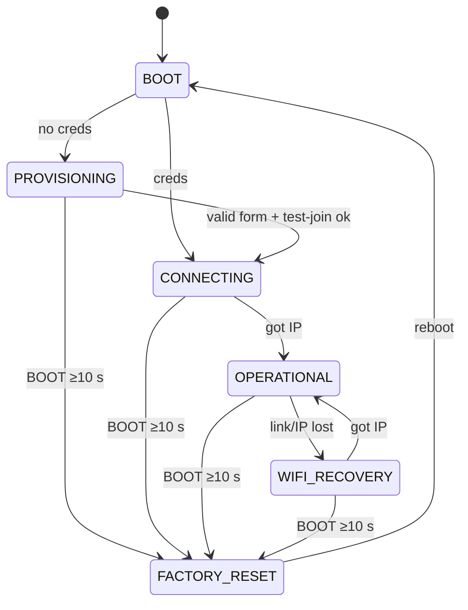

# MX320 WiFi Print Server — Functional Specification Document (FSD)

Provenance tags: `[user]` stated by the user · `[derived]` logical consequence of
a `[user]` decision · `[pack:esp32]` proposed by the ESP32 domain pack and
accepted by the user · `[tooling]` harvested from the sibling project's pinned
build tooling · `[proposed]` a value this document proposes that the user has not
yet accepted (`status: proposed` until accepted). Values accepted by the user
(OD-1, OD-2) carry no marker and are approved.

Requirement IDs follow `FR-<chapter>.<n>` / `NFR-<chapter>.<n>`. IDs are stable:
never renumbered, only `deprecated` or `superseded`.

## 1. System Overview

The MX320 WiFi Print Server makes a USB-only Canon PIXMA MX320 printable over
WiFi from macOS and Windows computers. A Seeed Studio XIAO ESP32-S3 is the USB
host for the printer and serves a raw (JetDirect, TCP 9100) print port on the
home WLAN. The client computer renders each job with its own MX320 driver; the
ESP32 forwards the resulting byte stream to the printer unchanged. Printer and
server status is visible on a web page and published to Home Assistant over
MQTT.

**Goals** `[user]`
- Print to the MX320 over WiFi from a Mac and from a Windows PC.
- Show printer status: presence, IEEE 1284 identity, ready / paper-out / error,
  job state — on an HTTP status page and over MQTT to Home Assistant.
- Join the WLAN through a captive portal; update firmware over WiFi (OTA).

**Goals** `[pack:esp32]`
- A task watchdog that turns a hung task into a reset.
- Factory reset by holding the BOOT button.
- Home Assistant MQTT discovery.

**Non-goals** `[user]` / `[derived]`
- No scanning, no fax (`[user]`: print + status only).
- No document rendering on the ESP32: no driverless AirPrint / IPP Everywhere /
  Mopria. Clients need an MX320-capable driver (`[derived]` — the MX320 speaks
  only Canon's proprietary raster, which the ESP32 cannot produce).
- No LPD, IPP, SMB, WSD or SNMP endpoints (`[user]`: RAW 9100 + mDNS).
- No bidirectional channel from printer to print client: data the printer
  returns on its bulk-IN endpoint is not forwarded to the TCP client (`[derived]`).
- No OTA rollback (offered, not selected — see §4 *Explicitly out of scope*).

**Users.** Household members printing from a Mac or Windows PC; the owner who
provisions, updates and recovers the device; Home Assistant as status consumer;
the testbench as automated observer during development.

**High-level flow.** Power on → no WiFi credentials: captive portal on a setup
SoftAP → credentials stored → join home WLAN → printer enumerated on USB →
`_pdl-datastream._tcp` advertised via mDNS → client opens TCP 9100 and streams a
rendered job → ESP32 writes the bytes to the printer's bulk-OUT endpoint → client
closes → job complete; status published.

## 2. System Architecture

### 2.1 Logical Architecture

```text
 Mac / Windows PC ──WiFi/LAN──▶ ESP32-S3 ──USB (host)──▶ active hub ──▶ Canon MX320
   (MX320 driver renders)       │  TCP 9100  RAW in                      (printer class)
                                │  mDNS      advertise
                                │  HTTP 80   status / settings / OTA
                                └─ MQTT 1883 ─▶ Home Assistant broker
```

Trust boundary: the home LAN (§22). The only path into the printer is the
ESP32's USB host port.

### 2.2 Hardware / Platform Architecture

**Product topology** `[user]`: the XIAO ESP32-S3's USB-C port (native USB-OTG,
GPIO19/20) is the **USB host**. It connects to the upstream port of an active
(self-powered) USB hub; the MX320 connects to a downstream port of that hub.

**Bench topology** `[user]`: identical product wiring, plus a USB-UART adapter
on XIAO D6/D7 (UART0, RX/TX/GND only) plugged into the testbench Pi
(192.168.8.70) — **not** into the product hub, whose host is the ESP32. No
BOOT or EN line is wired `[user]`, so the adapter carries the console only and
cannot enter download mode. The testbench reads and writes the console through
that adapter; every update goes over OTA (FR-11.3); logs also go to the
testbench UDP log (§20).

**Bench cold flash** — the only way to write the bootloader, partition table or
an erased flash, used for the first flash, recovery from an image that cannot
reach the network, and contracts whose precondition is a release build on
erased NVS: an operator, prompted through `/api/human-interaction`, unplugs the
XIAO's USB-C from the hub's upstream port and plugs it into the Pi **while
holding BOOT**, releasing it once plugged in — the chip starts in ROM download
mode (R7), which works whatever the installed firmware does with the USB PHY;
the testbench flashes through that native-USB slot (with erase where the
contract says so) and resets the chip; the operator moves the cable back. The MX320 is absent from the ESP during it.

Platform constraints — each one a number the build reads (§23 binds them to
build settings):

Every NFR-2.x constraint below is **[Must]**.

| ID | Constraint | Value | Source |
|---|---|---|---|
| NFR-2.1 | MCU | ESP32-S3 (Seeed XIAO ESP32-S3) | `[user]` |
| NFR-2.2 | Flash size the firmware requires | 8 MB; a unit with less than 8 MB flash cannot run this firmware | `[derived]` (XIAO ESP32-S3 fit) |
| NFR-2.3 | PSRAM | 8 MB octal PSRAM present and enabled | `[derived]` |
| NFR-2.4 | Console | UART0, TX = GPIO43 (D6), RX = GPIO44 (D7), 115200 8N1 | `[user]` (UART adapter) |
| NFR-2.5 | USB role | USB-OTG peripheral in host mode, full-speed (12 Mbit/s); USB-Serial/JTAG is not used as console | `[derived]` |
| NFR-2.6 | Factory-reset input | BOOT button, GPIO0, active low | `[pack:esp32]` |
| NFR-2.7 | USB hub depth | at most one external hub between ESP32 and printer | `[user]` |

| ID | Precondition · stimulus | Expected observation | Must NOT happen | Tier |
|---|---|---|---|---|
| NFR-2.1–2.3 | Chip read (§25.0) during a bench cold flash; then reset | Chip ESP32-S3, flash 8 MB; `boot:` marker with `flash=8 psram=8` | `psram=0` | bench (commissioning) |
| NFR-2.4 | Reset DUT, read UART adapter | Boot banner at 115200 on GPIO43 | Banner only on USB-Serial/JTAG | bench |
| NFR-2.5 | Attach printer to USB-C via hub | FR-8.1 passes | Console output on the USB-C port | bench |
| NFR-2.6 | Running · operator holds BOOT (§25.0 button press) for about 12 s | `button: held <ms> ms` with ms ≥ 10000, then `reset: factory` (FR-2.17) | `reset: factory` without a preceding `button: held` line | bench |
| NFR-2.7 | Printer behind two cascaded hubs | Printer not claimed; log `usb: hub depth exceeded` | Crash | bench |

Power: the XIAO and the hub are supplied by the hub's 5 V supply; the ESP32
cannot source USB VBUS. How VBUS reaches the hub's upstream port is a
commissioning question (§4, R1). **Bench power-off of the DUT** (the stimulus
"power off DUT" / "power-cycle" in any contract) means: an operator, prompted
through `/api/human-interaction`, disconnects the hub's 5 V supply and, for a
power-cycle, reconnects it after 5 s. The MX320 keeps its own mains supply.
The UART adapter stays powered from the bench and is not a power path to the
XIAO (capability `dut-power-cycle`).

### 2.3 Software Architecture

FreeRTOS tasks: USB host daemon + printer-class client; RAW job forwarder
(TCP → USB, one job at a time); HTTP server (status, settings, OTA, captive
portal); MQTT client; status poller; button monitor. Persistent state lives in
NVS (§16). Firmware updates use two OTA slots (§16).

#### State model — device lifecycle (normative)

States are mutually exclusive. Printer presence (§8) and job state (§6) are
orthogonal sub-states of `OPERATIONAL` and `WIFI_RECOVERY`.

| State | Meaning | Persistent? |
|---|---|---|
| `BOOT` | Reset until NVS read | no |
| `PROVISIONING` | No stored WiFi credentials; setup SoftAP + captive portal active | no (derived from NVS on each boot) |
| `CONNECTING` | Credentials stored; joining the WLAN for the first time since boot | no |
| `OPERATIONAL` | STA associated with an IPv4 address; network services up | no |
| `WIFI_RECOVERY` | Was operational; STA link or IP lost; reconnecting | no |
| `FACTORY_RESET` | Erasing user configuration, then rebooting | no |

Transition table — **the table is normative; every row is a requirement**
(`FR-2.<row>`):

| ID | From | Event | Guard | To | Action | Limit | Source |
|---|---|---|---|---|---|---|---|
| FR-2.10 | `BOOT` | NVS read | no WiFi credentials | `PROVISIONING` | Start setup SoftAP, DNS catch-all, portal | portal reachable ≤ 10 s after reset | `[derived]` |
| FR-2.11 | `BOOT` | NVS read | credentials present | `CONNECTING` | Start STA | ≤ 2 s after reset | `[derived]` |
| FR-2.12 | `CONNECTING` | got IPv4 | — | `OPERATIONAL` | Start RAW port (if printer present), mDNS, HTTP, MQTT | services up ≤ 5 s after IP | `[derived]` |
| FR-2.13 | `CONNECTING` | connect fails / timeout | — | `CONNECTING` | Retry with backoff 1, 2, 4 … 60 s, unbounded | ceiling 60 s | `[user]` (OD-2) |
| FR-2.14 | `OPERATIONAL` | STA disconnected | — | `WIFI_RECOVERY` | Abort active job (§6) | ≤ 2 s | `[derived]` |
| FR-2.15 | `WIFI_RECOVERY` | got IPv4 | — | `OPERATIONAL` | Restart services as FR-2.12 | RAW port accepting ≤ 30 s after AP returns | `[derived]` |
| FR-2.16 | `WIFI_RECOVERY` | connect fails | — | `WIFI_RECOVERY` | Retry, backoff as FR-2.13 | ceiling 60 s | `[user]` (OD-2) |
| FR-2.17 | any but `BOOT` | BOOT held ≥ 10 s | — | `FACTORY_RESET` | Erase user config (§19), reboot | reboot ≤ 3 s after threshold | `[pack:esp32]` |
| FR-2.20 | `OPERATIONAL` | IP lost, link up | — | `WIFI_RECOVERY` | Abort active job (§6) | ≤ 2 s | `[derived]` |
| FR-2.18 | `PROVISIONING` | valid form submitted and STA test-join succeeds | — | `CONNECTING` | Persist config, stop SoftAP | ≤ 5 s after test-join | `[derived]` |

Unhandled-event default: events not listed are logged at debug level and
discarded. Explicit exclusions: `PROVISIONING` never falls back to anything but
itself (no timeout reboot); `CONNECTING`/`WIFI_RECOVERY` never fall back to
`PROVISIONING` — the portal returns only via factory reset.
**FR-2.19** [Must] `[pack:esp32]`: a BOOT press shorter than 10 s shall have no effect in any state.

A watchdog reset (§17) enters `BOOT` like any other reset (NFR-17.x).

**Prohibited transitions**: `WIFI_RECOVERY → PROVISIONING`; any transition that
erases configuration other than FR-2.17; a reboot as the means of WiFi recovery.



Verification contracts for the lifecycle:

```yaml
id: FR-2.15
verification:
  preconditions:
    - DUT OPERATIONAL on the bench AP, printer present, RAW port accepting.
  stimulus:
    - Disable the bench AP for 20 s, then re-enable it.
  expected_observations:
    - Log marker `wifi: lost` after AP disable.
    - Log marker `wifi: got ip` after AP re-enable.
    - TCP connect to <ip>:9100 succeeds within 30 s of AP re-enable.
    - A 1 MiB test job sent after recovery arrives byte-identical at the USB sink.
  timing: 30 s from AP re-enable to RAW port accepting
  tolerance: +5 s
  prohibited_outcomes:
    - DUT reboots (boot counter / reset reason changes).
    - DUT starts the setup SoftAP.
    - Stored WiFi credentials change.
  tier: bench
  evidence: [AP toggle timestamps, UDP + UART log, /api/status before/after (boot_count, reset_reason), sink SHA-256]
  cleanup: [AP enabled, DUT OPERATIONAL]
```

```yaml
id: FR-2.17
verification:
  preconditions:
    - For CONNECTING, OPERATIONAL and WIFI_RECOVERY: WiFi credentials, admin password and MQTT settings stored (portal or /settings), DUT in that state.
    - For PROVISIONING: NVS erased (no credentials can exist in this state), DUT in PROVISIONING.
  stimulus:
    - Operator holds BOOT for about 12 s (§25.0 button press; `button: held <ms> ms` must show ≥ 10000, else the run is repeated) — once from each source state: PROVISIONING, CONNECTING (bench AP stopped), OPERATIONAL, WIFI_RECOVERY (AP disabled after OPERATIONAL); re-provision between runs.
  expected_observations:
    - Log marker `reset: factory` then a reboot.
    - After reboot the setup SoftAP `MX320-Setup-<id>` is visible within 10 s.
    - GET http://192.168.4.1/api/status shows `configured: false` and `state: PROVISIONING`.
    - `boot_count` equals its value before the reset plus 1 (retained per §19).
    - For the three provisioned source states: after re-provisioning with WiFi credentials and a new admin password different from the old one (no MQTT fields), `config.mqtt_host` and `config.mqtt_user` are empty, `config.mqtt_port` = 1883, `config.hostname` = `mx320-<id>`, and `POST /api/ota` with the old admin password answers 401.
  timing: reboot ≤ 3 s after the 10 s threshold
  tolerance: the 10 s threshold is judged from the DUT's own `button: held` ms (§25.0); the bench has no independent BOOT timing
  prohibited_outcomes:
    - DUT joins any network (home WLAN or bench AP) after reboot.
    - Old admin password or MQTT settings still in effect after re-provisioning.
    - `boot_count` restarted (erased with the user configuration).
    - The OTA slots or running firmware version change.
    - Reset fires on a hold whose `button: held` line shows < 10000 ms (see FR-2.19).
  tier: bench
  evidence: [operator prompt answers, UART log with `button: held`, SoftAP scan, /api/status]
  cleanup: [Re-provision DUT via portal (P-PROVISION)]
```

| ID | Precondition · stimulus | Expected observation | Must NOT happen | Tier |
|---|---|---|---|---|
| FR-2.10 | NVS erased · reset | SoftAP visible and `GET http://192.168.4.1/`, following redirects, ends in 200 with the setup page ≤ 10 s after reset | DUT joins any other network | bench |
| FR-2.11 | Credentials stored (FR-19.1 or portal) · reset | Log `state: CONNECTING` ≤ 2 s after reset | SoftAP started | target |
| FR-2.12 | Credentials stored, AP up; for the Phase 4 exit also printer present and broker configured · reset | Each ≤ 5 s after `wifi: got ip`: `/api/status` 200; mDNS A answer; TCP :9100 accepts; retained `online` on the broker (Phase 1 exit: `/api/status` only) | A service answering before `wifi: got ip` | bench |
| FR-2.13 | Credentials for the bench AP stored · reset with (a) the bench AP stopped, (b) the bench AP up with a different password | For 5 min: successive `wifi: retry in <n> s` lines carry n = 1, 2, 4, …, 60, 60; each next `wifi: connecting` follows its retry line after n s (±20 %) | SoftAP started; reboot | bench |
| FR-2.14 | Job in progress · AP disabled | UART `state: WIFI_RECOVERY` and `job: abort id=<n> reason=wifi` ≤ 2 s after the `wifi: lost` marker | DUT reboots; job later reported DONE | bench |
| FR-2.16 | WIFI_RECOVERY, AP kept off 5 min | Successive `wifi: retry in <n> s` lines carry n = 1, 2, 4, …, 60, 60; each next `wifi: connecting` follows its retry line after n s (±20 %) | Reboot; SoftAP; a retry earlier than n s | bench |
| FR-2.18 | PROVISIONING · submit valid form for the bench AP | `state: CONNECTING` ≤ 5 s after `portal: test-join ok`; then, with the bench AP stopped (state is no longer PROVISIONING, so no SoftAP may return), the setup SSID absent from a bench scan | Credentials persisted before test-join succeeded | bench |
| FR-2.20 | Feed `IP_LOST` to the lifecycle function in OPERATIONAL with a job active (the bench cannot revoke a DHCP lease) | Next state WIFI_RECOVERY; action abort job | Any other next state | host |
| FR-2.19 | In each of PROVISIONING (NVS erased), CONNECTING (credentials stored, bench AP stopped), OPERATIONAL, WIFI_RECOVERY (bench AP disabled after OPERATIONAL) · operator holds BOOT for about 7 s (§25.0 button press; `button: held` must show < 10000 ms, else repeat) | No state change; config unchanged; no reboot | `reset: factory` logged | bench |

### 2.4 Component Layering

Strict one-way dependency: each layer depends only on layers below it. The L0/L1
line is ownership — L0 is configured and used (ESP-IDF and managed components),
L1 is wire/handler logic this project writes and tests.

```text
┌──────────────────────────── L2  Application logic ─────────────────────────────┐
│  Device Lifecycle (§5)   Job Forwarder (§6)   Printer Status Derivation (§7)  │
├──────────────────────────── L1  Interfaces ────────────────────────────────────┤
│ USB Printer Link (§8)  RAW Port (§9)  Discovery (§10)  HTTP Status/Admin (§11) │
│ Captive Portal (§12)   MQTT / HA Publisher (§13)                               │
├──────────────────────────── L0  Foundation ────────────────────────────────────┤
│ WiFi STA/AP (§14)  USB Host Library + hub (§15)  NVS & OTA (§16)  RTOS/TWDT (§17)│
│ esp_http_server · esp-mqtt (managed) · mdns (managed) · lwIP                   │
└────────────────────────────────────────────────────────────────────────────────┘
```

Source-layout rules that make the code mirror these layers are HOW and live in
`docs/Method/project/architecture.md`.

## 3. Implementation Phases

Each phase is entered using only what earlier phases delivered.

### 3.1 Phase 1 — Platform alive on the bench

- **Scope:** build skeleton for ESP32-S3 with §23 constraints; UART0 console;
  boot banner; NVS; TWDT; lifecycle decision function; WiFi STA with
  credentials stored in NVS through the test build's UART credential command
  (FR-19.1 — no credentials are compiled into any image); WiFi recovery; UDP log;
  HTTP `/api/status` (`fw`, `boot_count`, `reset_reason`, `state`,
  `heap_free`); OTA endpoint (§11) authenticated by an admin password stored
  through the test build's UART `admin` command (FR-19.3); test-build watchdog
  fault-injection endpoint `/api/test/hang` (NFR-17.x, absent from release
  builds by NFR-17.6); test-build console commands `reboot` and `wipe`
  (FR-19.5–FR-19.8); `GET /api/slots` (FR-11.10).
- **Deliverables:** first firmware written by bench cold flash (§2.2); OTA path
  proven; every later Phase 1 image delivered by OTA.
- **Exit:** NFR-2.1–NFR-2.4, FR-5.1, FR-19.1–FR-19.8, NFR-17.6, FR-2.11, FR-2.12 (HTTP only), FR-2.13, FR-2.16, FR-2.20,
  FR-11.3, FR-11.4, FR-11.6, FR-11.10, NFR-17.1, NFR-17.5,
  FR-18.1 (banner + `/api/status`), FR-20.1–FR-20.2 (Phase 1 rows of the §20 marker table), NFR-23.1 pass.
- **Depends on:** commissioning of the UART adapter wiring and bench AP (Phase 2
  of the journey, `/commission`). Until OTA is proven, the XIAO's USB-C stays on
  the Pi so each image can be cold-flashed.

### 3.2 Phase 2 — USB printer link

- **Scope:** USB host + hub support; printer-class client (§8); status
  derivation (§7); printer fields in `/api/status`.
- **Exit:** FR-8.1–FR-8.4, FR-8.8, FR-8.9, FR-7.1, FR-7.2 (idle case a), NFR-2.5, NFR-2.7, NFR-17.3,
  FR-20.1–FR-20.2 (Phase 2 rows of the §20 marker table) pass;
  printer identity of the real MX320 visible in `/api/status`.
- **Depends on:** Phase 1 (`/api/status`, OTA, logging); commissioning of the
  ESP32 → hub → MX320 power/VBUS arrangement (R1, R2).

### 3.3 Phase 3 — Printing

- **Scope:** RAW port (§9), job forwarder (§6), mDNS discovery (§10), HTML
  status page (FR-11.1), `printing` and `job.*` fields in `/api/status`.
- **Exit:** FR-6.x (FR-6.9, FR-6.11, FR-6.12 via `/api/status`), NFR-6.1,
  FR-9.x, FR-10.x, FR-7.3, FR-8.5–FR-8.7, FR-2.15,
  FR-7.2 (mid-job case b), FR-11.1, FR-11.5, NFR-14.1, NFR-17.4, NFR-17.2, FR-2.14, FR-20.1–FR-20.2 (Phase 3 rows of the §20 marker table)
  pass at bench tier against the USB sink and the real MX320; acceptance AT-1
  (macOS) and AT-2 (Windows) pass.
- **Depends on:** Phase 2 (printer link), Phase 1 (WiFi, HTTP).

### 3.4 Phase 4 — Provisioning, settings, Home Assistant

- **Scope:** captive portal (§12), settings + admin password (FR-11.7–FR-11.8),
  factory reset (FR-2.17, FR-2.19), MQTT + HA discovery (§13), release-image check
  that no credentials are compiled in (FR-12.7).
- **Exit:** FR-2.10, FR-2.12 (all services), FR-2.17–FR-2.19,
  FR-11.2 (full Appendix B schema), NFR-16.1, NFR-2.6, FR-20.1–FR-20.2 (Phase 4 rows of the §20 marker table), FR-11.7, FR-11.9,
  FR-11.8, FR-12.x, FR-13.x, FR-18.1 (MQTT), NFR-22.x and every
  remaining Must/Should pass; AT-3 and AT-4 pass.
- **Depends on:** Phase 3 (job state to publish), Phase 1 (NVS, HTTP).

## 4. Risks, Assumptions & Dependencies

| ID | Risk | Likelihood | Impact | Mitigation |
|---|---|---|---|---|
| R1 | Hub does not enable downstream ports without VBUS on its upstream port, and the XIAO cannot source VBUS | Medium | High | Commission: measure upstream VBUS; feed hub 5 V to XIAO 5V pin (which is tied to USB-C VBUS) or use a hub that ignores upstream VBUS. Fallback: printer directly on XIAO USB-C with external 5 V. |
| R2 | ESP-IDF external-hub support (`CONFIG_USB_HOST_HUBS_SUPPORTED`) misbehaves with the chosen hub | Medium | High | Commission with the real hub in Phase 2; fallback: direct connection (FR-8.1 permits zero hubs). |
| R3 | MX320 port-status bits (paper-empty, select, not-error) are not maintained by Canon firmware | Medium | Medium | Commission: read port status with paper removed / lid open; if bits are static, FR-7.1 states degrade to `present`/`absent` and the spec is amended. |
| R4 | No MX320 driver for current macOS (Canon dropped support) | Medium | High | Dependency D3: Gutenprint "Canon PIXMA MX320" driver; AT-1 is the gate. |
| R5 | Windows Canon driver insists on bidirectional status and stalls on a raw port | Low | Medium | User manual: disable bidirectional support on the port. |
| R6 | Full-speed USB (≈ 1 MB/s) limits throughput | Low | Low | Printer mechanics are slower than the link; NFR-6.1 sized accordingly. |
| R7 | GPIO0 is a strapping pin; BOOT held during power-up enters download mode | Low | Low | Factory reset is detected only after boot (FR-2.17 guard "any but BOOT"). |

**Assumptions**
- A1 (assumed): the MX320 enumerates with an interface of class 0x07
  subclass 0x01 (USB printer class); VID 0x04A9 (Canon). Resolved by
  debugging-agenda item 4.
- A2 (assumed): the home WLAN is 2.4 GHz WPA2-PSK with DHCP; the Mac and PC are
  on the same L2 segment (mDNS reaches them). Resolved by debugging-agenda
  item 11.
- A3: AP outages use the testbench SoftAP, a declared bench capability taken
  at face value (`bench-wifi-ap`). The USB printer-class sink for byte-exact
  capture (§25.0) is project equipment that does not exist yet — debugging-agenda
  item 6, OD-4. The real MX320 is used for acceptance.

**Dependencies**
- D1 `[tooling]`: ESP-IDF v6.0.2 (`espressif/idf:v6.0.2` container, as in the
  sibling project); managed components `espressif/mdns`, `espressif/mqtt`.
- D2: Canon MX320 Windows driver (Canon download) on the Windows client.
- D3: Gutenprint (or Canon) MX320 driver on the macOS client.
- D4: An MQTT broker reachable from the WLAN (the Home Assistant broker) — only
  for §13.

**Explicitly out of scope**
- Scanning and fax `[user]`.
- LPD (515), IPP (631), SNMP `[user]` (offered, not selected).
- OTA rollback / boot-health confirmation `[pack:esp32]` (offered, not selected):
  a firmware that boots but cannot reach WiFi requires a bench cold flash
  (§2.2).
- Signed OTA images, secure boot, flash encryption `[user]` (security profile
  "Trusted home LAN", §22).
- ESP32 domain-pack families not selected in the curated subset: BLE, USB HID,
  Ethernet, offline MQTT buffering, MQTT commands (the device subscribes to no
  topic).

# Part A — Application Logic (L2)

## 5. Device Lifecycle

**Purpose.** Owns the state model in §2.3 — the normative transition table and
its contracts live there (FR-2.10 … FR-2.20) because the whole architecture
reads it. This chapter adds the decision function's own rule.

- **FR-5.1** [Must] `[derived]`: The lifecycle decision function shall be a
  pure function `(state, event, guard inputs) → (next state, actions)` whose
  outputs equal the §2.3 table for every listed row and return
  "ignored" for every unlisted (state × event) pair.

| ID | Precondition · stimulus | Expected observation | Must NOT happen | Tier |
|---|---|---|---|---|
| FR-5.1 | Enumerate all states × all events | Each listed row yields its next state/actions; each unlisted pair yields `ignored` | Any unlisted pair changes state | host |

## 6. Print Job Forwarder

**Purpose.** Moves one rendered job at a time from a RAW TCP connection (§9) to
the printer's bulk-OUT endpoint (§8), unchanged, with backpressure.

**Job state.** `IDLE → RECEIVING → DONE | ABORTED → IDLE`. A job begins when a
RAW connection is accepted and ends on client close (DONE) or on a fault
(ABORTED).

**Requirements**

- **FR-6.1** [Must] `[user]`: The device shall deliver every byte received on a
  RAW connection to the printer bulk-OUT endpoint in received order, without
  insertion, deletion or modification.
- **FR-6.2** [Must] `[derived]`: While a job is RECEIVING, the device shall not
  read data from any other RAW connection; bytes of two jobs shall never
  interleave.
- **FR-6.3** [Must] `[derived]`: A RAW connection queued behind an active job
  shall be serviced as the next job after the active job ends, without the
  client reconnecting (listen backlog ≥ 2).
- **FR-6.4** [Must] `[derived]`: On client close (TCP FIN) the device shall
  mark the job DONE only after the last byte has been accepted by the printer.
- **FR-6.5** [Must] `[derived]`: While the printer is not accepting data, the
  device shall stop reading from the TCP connection (backpressure).
- **FR-6.6** [Must] `[derived]`: If the printer detaches during a job, the
  device shall mark the job ABORTED and reset the TCP connection within 5 s
  of detach.
- **FR-6.7** [Should] `[derived]`: A job connection on which no byte arrives for
  300 s while the device is ready to read shall be closed and the
  job marked DONE.
- **FR-6.8** [Must] `[derived]`: Time spent with the printer not accepting data
  (paper out, cover open) shall not count towards the FR-6.7 idle limit.
- **FR-6.9** [Should] `[user]`: The status object (Appendix B `job.completed`)
  shall count jobs that reached DONE since boot.
- **FR-6.10** [Must] `[derived]`: Bytes held in device memory for the active
  job (`job.buffered_bytes`) shall never exceed 64 KiB.
- **FR-6.11** [Should] `[user]`: The status object (`job.aborted`) shall count
  jobs that reached ABORTED since boot.
- **FR-6.12** [Should] `[user]`: The status object (`job.last_bytes`) shall
  report the byte count of the most recent DONE job.
- **FR-6.13** [Must] `[derived]`: After marking a job DONE, the device shall
  close its side of the TCP connection within 1 s.
- **NFR-6.1** [Should] `[user]`: With a sink that accepts data at full
  speed, sustained client-to-USB throughput shall be ≥ 300 KiB/s over a 10 MiB
  job.

```yaml
id: FR-6.6
verification:
  preconditions:
    - DUT OPERATIONAL, printer (or USB sink) present, a 10 MiB job streaming.
  stimulus:
    - Detach the printer (hub port power off or cable pull) at ~50 % of the job.
  expected_observations:
    - Client sees connection reset ≤ 5 s after detach.
    - Log `job: abort id=<n> reason=usb` and `job.aborted` incremented.
    - After re-attach (FR-8.4), a new 1 MiB job prints byte-identical.
  timing: 5 s from detach to TCP RST
  tolerance: +1 s
  prohibited_outcomes:
    - DUT reboots.
    - The client sees a normal close (FIN) — the job would appear successful.
    - Bytes of the aborted job reach the printer after re-attach.
  tier: bench
  evidence: [detach timestamp, client socket error + timestamp, logs, /api/status, sink capture]
  cleanup: [printer attached, DUT idle]
```

| ID | Precondition · stimulus | Expected observation | Must NOT happen | Tier |
|---|---|---|---|---|
| FR-6.1 | Sink attached · send 10 MiB random job | Sink SHA-256 equals sent SHA-256 | Any byte difference or extra bytes | bench |
| FR-6.2 | Job A streaming · open job B and send 1 MiB | Sink receives all of A, then all of B | Any B byte before A's last byte | bench |
| FR-6.3 | Job A streaming · B then C connect and send, wait | B then C complete after A, in order, without reconnect | B or C refused or dropped | bench |
| FR-6.4 | Send job, close | `job: done` logged after the sink's last byte | `job: done` before the sink received the last byte | bench |
| FR-6.5 | Sink paused (NAKs) · client sends 5 MiB | Client send blocks within 5 s; bytes sent stop growing | Client keeps sending unbounded data | bench |
| FR-6.10 | Sink paused (NAKs) · client sends 5 MiB, poll `/api/status` every 0.5 s | `job.buffered_bytes` ≤ 65 536 in every sample | Any sample > 65 536; status unreachable > 2 s | bench |
| FR-6.7 | Printer or sink claimed · open connection, send 1 KiB, stay silent | Device closes connection 300 s (±5 s) later; job DONE | Close earlier than 295 s | bench |
| FR-6.8 | Sink paused 400 s mid-job, then resumed | Job continues and completes byte-identical | Connection closed during pause | bench |
| FR-6.9 | Run 2 complete jobs | `job.completed` +2 | Count changes on an aborted job | bench |
| FR-6.11 | Abort 1 job (client RST) | `job.aborted` +1 | `job.completed` changes | bench |
| FR-6.12 | Complete a 123 456-byte job | `job.last_bytes` = 123456 | Value from an aborted job | bench |
| FR-6.13 | Send job, close | Device FIN ≤ 1 s after `job: done` | Connection left half-open > 1 s | bench |
| NFR-6.1 | Sink at full speed · 10 MiB job | Throughput ≥ 300 KiB/s client-measured over the whole job | Sink receives fewer bytes than sent | bench |

## 7. Printer Status Derivation

**Purpose.** Maps USB presence plus the IEEE 1284 port-status byte (§8) to the
printer status reported by §11 and §13.

- **FR-7.1** [Must] `[user]`: The status function shall map inputs to exactly
  one state per this table, evaluated top to bottom:

| Input | State |
|---|---|
| no printer claimed | `absent` |
| port status unreadable (control transfer failed) | `unknown` |
| bit 5 (PaperEmpty) = 1 | `paper_out` |
| bit 3 (NotError) = 0 | `error` |
| bit 4 (Select) = 0 | `offline` |
| otherwise | `ready` |

- **FR-7.2** [Must] `[derived]`: The device shall refresh port status at least
  every 5 s while a printer is claimed, including during a job.
- **FR-7.3** [Should] `[derived]`: The `printing` flag shall be true exactly
  while a job is RECEIVING, independent of the FR-7.1 state.

| ID | Precondition · stimulus | Expected observation | Must NOT happen | Tier |
|---|---|---|---|---|
| FR-7.1 | Feed every bit combination + absent + unreadable | Table output for each | Two states for one input | host |
| FR-7.2 | Printer claimed · (a) idle: remove paper (MX320) or set sink port status paper-out; (b) during a streaming job: set sink port status paper-out | `/api/status` shows `paper_out` ≤ 5 s in both (MX320 subject to R3) | Status stale > 5 s | bench |
| FR-7.3 | Start / end a job | `printing` true during, false ≤ 1 s after DONE | `printing` true while IDLE | bench |

# Part B — Interfaces (L1)

## 8. USB Printer Link

**Purpose & peer.** Hand-written USB printer-class client (USB Printer Class
1.1) on the ESP-IDF USB Host Library. Peer: the MX320 printer interface, direct
or behind one hub.

**Protocol.** Interface class 0x07, subclass 0x01, protocol 0x01 or 0x02.
Bulk-OUT for job data; bulk-IN drained and discarded; class requests
GET_DEVICE_ID (bRequest 0), GET_PORT_STATUS (1), SOFT_RESET (2).

- **FR-8.1** [Must] `[user]`: The device shall claim the first printer-class
  interface of a device attached directly or through one hub within 5 s
  of attach.
- **FR-8.2** [Must] `[user]`: On claim the device shall read the printer's
  IEEE 1284 Device ID (GET_DEVICE_ID).
- **FR-8.9** [Must] `[derived]`: The Device ID parser shall extract the
  `MFG`/`MANUFACTURER`, `MDL`/`MODEL` and `CMD`/`COMMAND SET` values.
- **FR-8.3** [Must] `[derived]`: The device shall report the printer `absent`
  within 2 s of detach.
- **FR-8.4** [Must] `[derived]`: A printer re-attached after detach shall be
  re-claimed per FR-8.1 without a device reboot.
- **FR-8.5** [Should] `[derived]`: A USB device without a printer-class
  interface shall not be claimed.
- **FR-8.8** [Should] `[derived]`: Attaching or detaching another USB device
  on the hub shall not release a claimed printer.
- **FR-8.6** [Should] `[derived]`: A missing or unparseable Device ID shall
  leave the printer claimed, usable for printing, with model `unknown`.
- **FR-8.7** [Must] `[derived]`: After a job ABORTED with the printer still
  attached, the device shall issue SOFT_RESET before the next job.

| ID | Precondition · stimulus | Expected observation | Must NOT happen | Tier |
|---|---|---|---|---|
| FR-8.1 | DUT running · attach MX320 (a) via the hub, (b) directly to the XIAO USB-C (powered per R1) | Log `usb: printer claimed vid=04a9 pid=…` ≤ 5 s; `/api/status` printer present | Claim of the scanner interface | bench |
| FR-8.2 | Sink with Device ID `MFG:TestCo;MDL:Sink 1;` attached (or the MX320) | `/api/status` `printer.mfg`/`mdl` equal the device's values ≤ 5 s after claim | `mdl` null or stale from a previous printer | bench |
| FR-8.9 | Feed sample 1284 strings (incl. long-key form, missing fields, no trailing `;`) | Parser returns MFG/MDL/CMD per sample | Crash; read past length | host |
| FR-8.3 | Printer claimed · detach | `absent` ≤ 2 s | DUT reboot | bench |
| FR-8.4 | Detach, re-attach 10× | Claimed each time ≤ 5 s; boot_count unchanged | Reboot; leaked handles (`heap_free` drops > 4 KiB over 10 cycles) | bench |
| FR-8.5 | Attach only a USB flash drive on the hub | No `usb: printer claimed`; `printer.present` false | Drive claimed | bench |
| FR-8.8 | Printer claimed · attach then detach a flash drive | `printer.present` stays true; no `usb: printer absent` | Printer released | bench |
| FR-8.6 | Sink set to, in turn: (a) zero-length Device ID, (b) STALL on GET_DEVICE_ID, (c) `\x00\xff;;` with no MFG/MDL keys | Each: claimed, `printer.mdl` = `unknown`, a 1 KiB job completes | Interface rejected; crash | bench |
| FR-8.7 | Abort a job (client RST) with printer attached | Log `usb: soft_reset` before next job start | Next job starts without reset | bench |

## 9. RAW Print Port

**Purpose & peer.** JetDirect-style raw socket for print clients. Protocol:
TCP port 9100, client → device byte stream, no response data, end of job =
client close.

- **FR-9.1** [Must] `[user]`: In `OPERATIONAL` with a printer claimed, the
  device shall accept TCP connections on port 9100 of its STA address.
- **FR-9.2** [Must] `[derived]`: With no printer claimed, connection attempts to
  port 9100 shall be refused (TCP RST), so the client keeps the job queued.
- **FR-9.3** [Must] `[derived]`: The device shall send no payload bytes to a
  RAW client.

| ID | Precondition · stimulus | Expected observation | Must NOT happen | Tier |
|---|---|---|---|---|
| FR-9.1 | Printer present · TCP connect :9100 | Connection established | Refused | bench |
| FR-9.2 | Printer absent · TCP connect :9100 | Connection refused | Connection accepted and data discarded | bench |
| FR-9.3 | Send a job, read socket | 0 bytes received before close | Any byte | bench |

## 10. Discovery (mDNS / DNS-SD)

**Purpose & peer.** Lets macOS and Windows find the printer. Peer: any mDNS
querier on the LAN.

- **FR-10.1** [Must] `[user]`: In `OPERATIONAL`, the device shall answer mDNS A
  queries for `<hostname>.local` with its STA address.
- **FR-10.2** [Must] `[user]`: While a printer is claimed, the device shall
  advertise `_pdl-datastream._tcp` on port 9100 with instance name
  `<MDL> @ <hostname>` and TXT keys `txtvers=1`, `qtotal=1`, `ty=<MFG> <MDL>`,
  `product=(<MDL>)`, `usb_MFG=<MFG>`, `usb_MDL=<MDL>`.
- **FR-10.3** [Must] `[derived]`: The FR-10.2 service shall be withdrawn
  (goodbye packet) within 5 s of the printer becoming `absent`.
- **FR-10.4** [Should] `[derived]`: In `OPERATIONAL`, the device shall advertise
  `_http._tcp` on port 80.

| ID | Precondition · stimulus | Expected observation | Must NOT happen | Tier |
|---|---|---|---|---|
| FR-10.1 | OPERATIONAL · `dns-sd -G v4 <hostname>.local` / avahi-resolve | Resolves to STA IP | Any other address (e.g. 192.168.4.1) | bench |
| FR-10.2 | Printer present · browse `_pdl-datastream._tcp` | Instance named `<MDL> @ <hostname>` found with exact TXT keys/values; TXT-builder unit test passes | Other instance name; missing key; port ≠ 9100 | host + bench |
| FR-10.3 | Detach printer | Service removed from browse ≤ 5 s after the `usb: printer absent` marker | Service lingers | bench |
| FR-10.4 | Browse `_http._tcp` | Instance on port 80 | Port ≠ 80; instance missing | bench |

## 11. HTTP Status, Settings & OTA

**Purpose & peer.** Port 80, browser and scripts on the LAN. Status read
endpoints are unauthenticated; settings and OTA require the admin password via
HTTP Basic auth (user `admin`) — §22.

- **FR-11.1** [Must] `[user]`: `GET /` shall return an HTML page showing printer
  state, model, job counters, `printing`, WiFi RSSI and firmware version.
- **FR-11.2** [Must] `[user]`: `GET /api/status` shall return JSON matching the
  Appendix B schema within 2 s.
- **FR-11.3** [Must] `[user]`: `POST /api/ota` with valid credentials and a
  valid ESP32-S3 app image shall write the image to the inactive slot, reply
  200, and reboot into it within 5 s of the reply.
- **FR-11.4** [Must] `[derived]`: `POST /api/ota` without valid credentials
  shall return 401 and write nothing to flash.
- **FR-11.5** [Must] `[derived]`: `POST /api/ota` while a job is RECEIVING shall
  return 409 and write nothing to flash.
- **FR-11.6** [Must] `[derived]`: An image with bad magic, wrong chip ID, or
  size > 3 MB shall be rejected with 400; the device shall keep running the
  current firmware without reboot.
- **FR-11.7** [Must] `[user]`: `GET/POST /settings` (hostname, MQTT host/port/
  user/password, admin password change) shall require valid credentials;
  without them it shall return 401 and change nothing.
- **FR-11.8** [Must] `[derived]`: Settings changes shall be validated per §19;
  an invalid field shall be rejected with 400 naming the field, and no field of
  that submission shall be persisted.
- **FR-11.9** [Must] `[user]`: An authenticated `POST /settings` whose fields
  are all valid shall answer 200, persist every submitted field, and apply each
  with the §19 *Change effect* of that field.
- **FR-11.10** [Must] `[derived]`: `GET /api/slots` shall return, within 5 s,
  JSON `{"running": "ota_0"|"ota_1", "ota_0_sha256": <hex>, "ota_1_sha256": <hex>}`,
  each hash computed on that request over all 0x300000 bytes of the partition
  read from flash (no cached value). No authentication; release and test builds.

```yaml
id: FR-11.3
verification:
  preconditions:
    - DUT OPERATIONAL running version V1; image V2 (different version string) built.
  stimulus:
    - curl -u admin:<pw> -F image=@V2.bin http://<ip>/api/ota
  expected_observations:
    - HTTP 200.
    - Reboot within 5 s (log `boot: fw=V2`).
    - /api/status reports `fw` = V2, `reset_reason` = SW.
  timing: reboot ≤ 5 s after the 200
  tolerance: +2 s
  prohibited_outcomes:
    - Boot into V1 (slot not switched).
    - Stored configuration lost (DUT starts the SoftAP).
  tier: bench
  evidence: [curl output, UART log, /api/status before/after]
  cleanup: [OTA back to the baseline version]
```

| ID | Precondition · stimulus | Expected observation | Must NOT happen | Tier |
|---|---|---|---|---|
| FR-11.1 | GET / | 200, HTML containing the six fields | Password values present | bench |
| FR-11.2 | GET /api/status | Valid against Appendix B schema; ≤ 2 s | Missing required key | host (serializer) + bench |
| FR-11.10 | (a) Bench cold flash with erase of test image X, then `cred` (FR-19.1) and `reboot` (FR-19.5) to reach OPERATIONAL: GET; (b) then OTA image Y (FR-11.3) without reboot: GET | (a) `running` = `ota_0`; `ota_0_sha256` = SHA-256 of X padded with 0xFF to 0x300000; `ota_1_sha256` = SHA-256 of 0x300000 bytes of 0xFF. (b) `ota_1_sha256` differs from (a); `ota_0_sha256` unchanged; each answer ≤ 5 s | A hash equal to its value before (b) for the slot just written; auth demanded |
| FR-11.4 | POST image, no / wrong auth | 401; SHA-256 of `ota_0` and `ota_1` (slot read, §25.0) unchanged | Flash write | bench |
| FR-11.5 | Job streaming · POST valid image | 409; job completes byte-identical; inactive-slot SHA-256 (slot read, §25.0) unchanged | Reboot mid-job; inactive slot written | bench |
| FR-11.6 | Valid credentials · POST (a) an image whose first byte ≠ 0xE9, (b) an ESP32-C3 image, (c) a valid ESP32-S3 image (magic 0xE9, ESP32-S3 chip ID) padded to 3 145 729 bytes (0x300001), so only its size is wrong | 400; no reboot; version unchanged | Boot into partial image | bench |
| FR-11.7 | GET /settings and POST /settings, each without auth | Both 401; `/api/status` `config.*` unchanged | Settings page served; any field persisted | bench |
| FR-11.9 | DUT on the home WLAN (HA broker reachable), valid credentials · POST hostname `mx320-new`, MQTT host/port/user/password of the HA broker, admin_pass `newpass12`; then reset | 200; at once: `config.mqtt_*` show the new values, the old admin password gets 401 and `newpass12` 200; after the reset: `config.hostname` = `mx320-new`, `mx320-new.local` resolves, `mqtt.connected: true` ≤ 30 s after `wifi: got ip` | A submitted field not persisted; admin change waiting for a reboot | bench |
| FR-11.8 | Valid credentials · POST one invalid field at a time together with one valid change to another field (MQTT port 1884; hostname `mx320-new` when the port is under test): hostname `bad host!` / 33 chars / `-x` / `x-`; mqtt_host `bad host!` / 65 chars; mqtt_port 0 / 65536; mqtt_user 65 chars; mqtt_pass 65 chars; admin_pass 7 / 65 chars | Each 400 naming the field; the valid companion field still holds its old value in `config.*` | Partial persist; any invalid value accepted | host (validator) + bench |

## 12. Captive Portal

**Purpose & peer.** First-time WiFi setup from a phone or laptop while in
`PROVISIONING`. SoftAP SSID `MX320-Setup-<id>` (id per §18), open, IP
192.168.4.1; DNS catch-all answers every name with 192.168.4.1.

- **FR-12.1** [Must] `[user]`: In `PROVISIONING`, an HTTP GET via the SoftAP to
  any host and path other than `http://192.168.4.1/api/status` shall return the
  setup page or a redirect to it (captive-portal detection on macOS, Windows,
  iOS, Android).
- **FR-12.2** [Must] `[user]`: The setup page shall list the SSIDs found by a
  WiFi scan.
- **FR-12.8** [Must] `[user]`: The setup form shall accept a manually entered
  SSID, WiFi password and admin password, and optional hostname and MQTT host,
  port, user and password.
- **FR-12.3** [Must] `[derived]`: Before persisting, the device shall test-join
  the submitted network (AP+STA); on failure within 20 s it shall
  show an error on the page, stay in `PROVISIONING`, and persist nothing.
- **FR-12.4** [Must] `[derived]`: Portal submissions violating any §19 rule of
  a field the form accepts (FR-12.8) shall be rejected with a field error and
  persist nothing.
- **FR-12.5** [Must] `[derived]`: The SoftAP shall exist only in `PROVISIONING`.
- **FR-12.6** [Should] `[derived]`: The portal shall never echo the WiFi or
  admin password back in any response.
- **FR-12.7** [Must] `[derived]`: Release firmware shall contain no compiled-in
  WiFi credentials (bench credentials reach a test build only through FR-19.1).

| ID | Precondition · stimulus | Expected observation | Must NOT happen | Tier |
|---|---|---|---|---|
| FR-12.1 | PROVISIONING · join SoftAP, GET each OS probe: http://captive.apple.com/hotspot-detect.html (macOS, iOS), http://www.msftconnecttest.com/connecttest.txt (Windows), http://connectivitycheck.gstatic.com/generate_204 (Android), http://example.com/ | Each returns the setup page or a 302 to it | A probe getting its "online" answer (`Success`, `Microsoft Connect Test`, 204); DNS failure | bench |
| FR-12.2 | Bench AP up · GET setup page | Scan list includes the bench AP SSID | Empty list while the bench AP is up | bench |
| FR-12.8 | Submit all fields (manual SSID = home WLAN, where the HA broker is reachable; hostname `mx320-test`, MQTT host/port/user/password) | After provisioning, `/api/status` `config.hostname`/`mqtt_host`/`mqtt_port`/`mqtt_user` equal the submitted values; GET /settings with the submitted admin password returns 200; with the broker requiring that MQTT user/password (HA broker), `mqtt.connected: true` ≤ 30 s | A submitted field silently dropped; `mqtt.connected: false` with the right password | bench |
| FR-12.3 | Submit bench SSID with wrong password | Error shown ≤ 20 s; still PROVISIONING; NVS has no creds after reboot | Credentials persisted | bench |
| FR-12.4 | Submit, one invalid field at a time: SSID empty / 33 bytes; WiFi password 7 / 64 chars; admin password 7 / 65 chars; hostname `bad host!` / 33 chars / `-x` / `x-`; mqtt_host `bad host!` / 65 chars; mqtt_port 0 / 65536; mqtt_user 65 chars; mqtt_pass 65 chars | Each rejected with an error naming its field; nothing persisted | Any of them accepted or persisted | host (validator) + bench |
| FR-12.5 | OPERATIONAL · scan from bench | No `MX320-Setup-*` SSID | SoftAP visible | bench |
| FR-12.6 | Known WiFi and admin passwords · capture every portal response: the setup page before submit, the error response to an invalid submit, the response to a failed test-join, the success response, and the setup page fetched again after each | Password fields empty in every capture | Either password value in any capture | bench |
| FR-12.7 | `strings` on release image | Bench SSID/password absent | Present | other (CI) |

## 13. MQTT / Home Assistant Publisher

**Purpose & peer.** Publishes status to an MQTT broker (Home Assistant). MQTT is
disabled while the broker host setting is empty. Base topic
`mx320/<id>`. QoS 1 for state and availability, retained.

- **FR-13.1** [Must] `[user]`: With a broker configured, the device shall
  publish the Appendix B status object to `mx320/<id>/state` (retained) within
  2 s of any change of printer state, `printing`, or job counters.
- **FR-13.2** [Should] `[derived]`: The device shall also republish
  `mx320/<id>/state` every 60 s.
- **FR-13.3** [Must] `[derived]`: On each broker connect the device shall
  publish `online` (retained) to `mx320/<id>/availability`.
- **FR-13.7** [Must] `[derived]`: The device shall register `offline`
  (retained) on `mx320/<id>/availability` as its MQTT last-will, with an MQTT
  keepalive of 30 s.
- **FR-13.4** [Should] `[pack:esp32]`: On each broker connect the device shall
  publish retained Home Assistant discovery configs under
  `homeassistant/<component>/mx320_<id>/<object>/config` for: printer state
  (sensor), printing (binary_sensor), printer connected (binary_sensor), jobs
  completed (sensor), WiFi RSSI (sensor, diagnostic) — all with a shared
  `device` block (identifiers `mx320_<id>`, model `<MDL>`, sw_version).
- **FR-13.5** [Must] `[derived]`: Broker unavailability shall not affect
  printing.
- **FR-13.6** [Must] `[derived]`: After the broker becomes reachable again the
  device shall reconnect and publish current state within 30 s.

```yaml
id: FR-13.5
verification:
  preconditions:
    - DUT OPERATIONAL, broker configured and connected, printer present.
  stimulus:
    - Stop the broker; while stopped send a 5 MiB job; restart broker after 60 s.
  expected_observations:
    - Job completes byte-identical while broker is down.
    - FR-13.6 - state message with updated `job.completed` ≤ 30 s after broker restart.
  timing: 30 s from broker restart to fresh state message (FR-13.6)
  tolerance: +5 s
  prohibited_outcomes:
    - RAW port refuses or aborts the job.
    - DUT reboots.
    - Stale state (old `job.completed`) published as the recovery message.
  tier: bench
  evidence: [broker stop/start timestamps, sink hash, MQTT capture, /api/status boot_count]
  cleanup: [broker running]
```

| ID | Precondition · stimulus | Expected observation | Must NOT happen | Tier |
|---|---|---|---|---|
| FR-13.1 | Subscribed · (a) start a job, (b) complete it, (c) set the sink's port status to paper-out, (d) abort a job (client RST) | A new retained state ≤ 2 s after each: (a) `printing: true`, (b) `job.completed` +1, (c) `printer.status: paper_out`, (d) `job.aborted` +1 | Message without retain flag; a message still showing the previous value | bench |
| FR-13.2 | Idle 3 min | ≥ 3 state messages | Gap > 70 s | bench |
| FR-13.3 | Subscribe · (a) reset DUT; (b) restart a broker that keeps no persistence (bench broker) while the DUT runs | Retained `online` (a) ≤ 5 s after `wifi: got ip`, (b) ≤ 30 s after the broker restart | No retained flag; `online` missing after the broker restart | bench |
| FR-13.7 | Power off DUT (§2.2 bench power-off) | Broker publishes retained `offline` ≤ 45 s after power-off (1.5 × keepalive, MQTT 3.1.1 §3.1.2.10) | Retained `online` stays | bench |
| FR-13.4 | (a) DUT connects; (b) restart a broker that keeps no persistence while the DUT runs · read retained `homeassistant/#` after each | Five configs, schema-valid, same device block — (b) ≤ 30 s after the broker restart | Discovery for non-listed entities; configs missing after the broker restart | host (builder) + bench |
| FR-13.6 | see FR-13.5 contract | — | — | bench |

# Part C — Foundation (L0)

L0 services are configured, not owned; they are tested **transitively** through
the L1/L2 contracts referenced in each chapter.

## 14. WiFi STA / SoftAP

ESP-IDF WiFi driver in STA, AP (provisioning) and AP+STA (test-join) modes.
Exercised via FR-2.11–FR-2.18 and §12.

- **NFR-14.1** [Must] `[derived]`: In `OPERATIONAL` and idle, 19 of 20 mDNS A
  queries and 19 of 20 TCP connects to port 9100 shall be answered within
  500 ms. (Implementation note — power-save off — lives in the
  Method.)

| ID | Precondition · stimulus | Expected observation | Must NOT happen | Tier |
|---|---|---|---|---|
| NFR-14.1 | Idle 2 min · 20 mDNS queries, 20 connects, 3 s apart | ≥ 19 of each answered ≤ 500 ms | 2 or more of either left unanswered after 2 s; reboot | bench |

## 15. USB Host Library and Hub Support

ESP-IDF USB Host Library with external-hub support enabled. Exercised via §8.
Configuration bound in §23.

## 16. NVS and OTA Partitions

NVS holds the §19 persisted fields. Two OTA app slots; no factory app. Exercised
via FR-2.17, FR-11.3–FR-11.6, FR-12.3.

- **NFR-16.1** [Must] `[derived]`: Configuration stored in NVS shall survive OTA
  update and power cycle.

| ID | Precondition · stimulus | Expected observation | Must NOT happen | Tier |
|---|---|---|---|---|
| NFR-16.1 | Provisioned DUT on the home WLAN with the HA broker configured · OTA to new version, then power-cycle (§2.2) | Rejoins WLAN; `config.hostname`, `config.mqtt_host`, `config.mqtt_port`, `config.mqtt_user` unchanged in `/api/status`; GET /settings with the stored admin password returns 200; `mqtt.connected: true` ≤ 30 s (broker requires the stored MQTT password) | SoftAP started; a setting at default; admin or MQTT password lost | bench |

## 17. RTOS and Task Watchdog

- **NFR-17.1** [Must] `[pack:esp32]`: When the main task fails to check in
  with the task watchdog for 10 s, the device shall reset, and the next boot
  shall report reset reason `TASK_WDT`.
- **NFR-17.3** [Must] `[pack:esp32]`: As NFR-17.1, for the USB printer client
  task.
- **NFR-17.4** [Must] `[pack:esp32]`: As NFR-17.1, for the job forwarder task.
- **NFR-17.5** [Must] `[pack:esp32]`: As NFR-17.1, for the HTTP server task.
- **NFR-17.6** [Must] `[derived]`: A release build shall answer any request to
  `/api/test/hang` with 404 and hang no task.
- **NFR-17.2** [Must] `[derived]`: A printer stall (paper out) of 10 min during
  a job shall not trigger a watchdog reset.

```yaml
id: NFR-17.1
verification:
  preconditions:
    - DUT running a test build with the fault-injection hook (`/api/test/hang?task=<main|usb|forwarder|http>`, test build only).
  stimulus:
    - Trigger the hang with `task=main` (NFR-17.3: `usb`, NFR-17.4: `forwarder`, NFR-17.5: `http` — same contract, same observations).
  expected_observations:
    - Reset within 10 s (+2 s) of the trigger.
    - After reboot /api/status reset_reason = TASK_WDT, boot_count +1.
    - DUT returns to OPERATIONAL without operator action.
  timing: 10 s
  tolerance: +2 s
  prohibited_outcomes:
    - DUT stays hung (no reset within 15 s).
    - Reset reason reported as anything other than TASK_WDT.
    - Release image exposes the hang endpoint (NFR-17.6).
  tier: bench
  evidence: [trigger timestamp, UART log incl. panic output, /api/status after]
  cleanup: [OTA the baseline release image (FR-11.3)]
```

| ID | Precondition · stimulus | Expected observation | Must NOT happen | Tier |
|---|---|---|---|---|
| NFR-17.3 | As NFR-17.1 contract, `task=usb` | reset ≤ 12 s; reset_reason TASK_WDT | DUT stays hung | bench |
| NFR-17.4 | As NFR-17.1 contract, `task=forwarder` | reset ≤ 12 s; reset_reason TASK_WDT | DUT stays hung | bench |
| NFR-17.5 | As NFR-17.1 contract, `task=http` | reset ≤ 12 s; reset_reason TASK_WDT | DUT stays hung | bench |
| NFR-17.6 | Release build on the network: on a test build store credentials (`cred`) and admin password `oldpass12` (`admin`), then OTA to the release image (NVS survives OTA) · GET `/api/test/hang?task=main`, wait 15 s | 404; `boot_count` unchanged | Any reset; any 2xx | bench |
| NFR-17.2 | Sink paused 10 min during a job | No reset; job completes after resume | reset_reason TASK_WDT | bench |

# Part D — Cross-cutting Concerns

## 18. Device Identity

- `<id>`: lowercase hex of the last 3 bytes of the WiFi STA MAC (e.g. `a1b2c3`).
- Default hostname: `mx320-<id>`.
- Firmware version: the git tag (`vX.Y.Z`), or `vX.Y.Z-<n>-g<sha>` between tags,
  embedded at build time.
- **FR-18.1** [Must] `[derived]`: The firmware version reported by `/api/status`,
  the boot banner and MQTT `sw_version` shall be the same string.

| ID | Precondition · stimulus | Expected observation | Must NOT happen | Tier |
|---|---|---|---|---|
| FR-18.1 | Boot tagged build | Same version in UART banner, /api/status, discovery config | Mismatch | bench |

## 19. Configuration Catalogue

| Name | Type | Default | Valid range | Persistence | Sensitivity | Interface | Change effect | Factory reset |
|---|---|---|---|---|---|---|---|---|
| `wifi_ssid` | string | none | 1–32 bytes | NVS | operational | portal | next boot | cleared |
| `wifi_pass` | string | none | empty (open) or 8–63 chars | NVS | secret | portal | next boot | cleared |
| `admin_pass` | string | none | 8–64 chars | NVS | secret | portal, /settings, test-build UART (FR-19.3) | immediate | cleared |
| `hostname` | string | `mx320-<id>` | 1–32 chars `[a-z0-9-]`, not starting/ending `-` | NVS | public | portal, /settings | next boot | default |
| `mqtt_host` | string | empty (MQTT off) | empty, IPv4 dotted quad, or DNS name ≤ 64 chars | NVS | operational | portal, /settings | next MQTT connect | cleared |
| `mqtt_port` | int | 1883 | 1–65535 | NVS | public | portal, /settings | next MQTT connect | default |
| `mqtt_user` | string | empty | 0–64 chars | NVS | operational | portal, /settings | next MQTT connect | cleared |
| `mqtt_pass` | string | empty | 0–64 chars | NVS | secret | portal, /settings | next MQTT connect | cleared |
| `udp_log_host` | IPv4 | build-time: empty in release, `192.168.8.70` in test builds `[proposed]` | IPv4 dotted quad or empty | build-time | public | build | rebuild | n/a |
| `boot_count` | uint32 | 0 | — | NVS | public | read-only | each boot +1 | retained |

- **FR-19.1** [Must] `[derived]`: A test build (`CONFIG_PRINTSERVER_TEST_BUILD`)
  shall accept the UART0 console line `cred <ssid> <password>`, store the
  credentials in NVS, and log `cred: stored`.
- **FR-19.2** [Must] `[derived]`: A release build shall ignore the `cred` console
  line and change nothing in NVS.
- **FR-19.3** [Must] `[derived]`: A test build shall accept the UART0 console
  line `admin <password>` (8–64 chars), store it as `admin_pass`, and log
  `admin: stored`.
- **FR-19.4** [Must] `[derived]`: A release build shall ignore the `admin`
  console line and change nothing in NVS.
- **FR-19.5** [Must] `[derived]`: A test build shall accept the UART0 console
  line `reboot`, log `reboot: requested` and restart (reset reason `SW`) — the
  bench's reset, since no EN line is wired (§2.2).
- **FR-19.6** [Must] `[derived]`: A test build shall accept the UART0 console
  line `wipe`, erase the whole `nvs` partition (including `boot_count`), log
  `wipe: done` and restart — the bench's "NVS erased" precondition on a test
  build.
- **FR-19.7** [Must] `[derived]`: A release build shall ignore the `reboot`
  console line.
- **FR-19.8** [Must] `[derived]`: A release build shall ignore the `wipe`
  console line and change nothing in NVS.

| ID | Precondition · stimulus | Expected observation | Must NOT happen | Tier |
|---|---|---|---|---|
| FR-19.1 | Test build, NVS erased, PROVISIONING · write `cred <bench SSID> <pass>` via `/api/serial/write`, reset | `cred: stored`; after reset `state: CONNECTING` then `wifi: got ip` | `state: PROVISIONING` after the reset | bench |
| FR-19.2 | Release build, NVS erased · write the same line, reset | No `cred: stored`; after reset `state: PROVISIONING`, and again after a second power-cycle | `cred: stored`; `state: CONNECTING` after either reset | bench |
| FR-19.3 | Test build, credentials stored via `cred` (FR-19.1), OPERATIONAL · write `admin testpass1`; then `POST /api/ota` of a valid image with `admin:testpass1` | `admin: stored`; OTA answers 200 | OTA 401 with the stored password | bench |
| FR-19.4 | Release build on the network: on a test build store credentials (`cred`) and admin password `oldpass12` (`admin`), then OTA to the release image (NVS survives OTA) · write `admin testpass1`; then `POST /api/ota` with `admin:testpass1` | No `admin: stored`; OTA answers 401; inactive-slot SHA-256 (slot read, §25.0) unchanged | OTA accepted with that password | bench |
| FR-19.5 | Test build, OPERATIONAL, `boot_count` = n · write `reboot` | `reboot: requested`, then within 5 s `boot: … reset=SW count=<n+1>` | No restart within 5 s; a reset reason other than `SW` | bench |
| FR-19.6 | Test build with credentials stored, OPERATIONAL · write `wipe` | `wipe: done`, then within 5 s `boot: … count=1` and `state: PROVISIONING` | `state: CONNECTING` after the restart; `count` > 1 | bench |
| FR-19.7 | Release build on the network (as FR-19.4), `boot_count` = n · write `reboot`, wait 10 s | No `reboot: requested`; no `boot:` line; `/api/status` `boot_count` still n | Any restart within the 10 s | bench |
| FR-19.8 | Release build on the network (as FR-19.4) · write `wipe`, wait 10 s, then operator power-cycle (§2.2) | No `wipe: done`; after the power-cycle `state: CONNECTING` and `boot_count` = previous + 1 | `state: PROVISIONING`; `boot_count` = 1 | bench |

Each validation rule owes a negative test (FR-11.8, FR-12.4); each persistence
rule owes a persistence test (NFR-16.1, FR-2.17).

## 20. Logging / Observability

UART0 at 115200 (§2.2) and, when `udp_log_host` is set, the same lines as UDP
datagrams to `<udp_log_host>:5555` (testbench UDP log).

- **FR-20.1** [Must] `[derived]`: The device shall emit these marker lines,
  which tests match, each when its stimulus occurs (table below; the Phase
  column is the earliest phase that can produce it):

| Marker (exact format) | Stimulus that produces it | Phase |
|---|---|---|
| `boot: fw=<ver> reset=<reason> count=<n> flash=<MB> psram=<MB>` | any reset | 1 |
| `state: CONNECTING` | reset with credentials stored | 1 |
| `state: PROVISIONING` | reset with NVS erased | 1 |
| `state: OPERATIONAL` | AP up, credentials stored, reset | 1 |
| `state: WIFI_RECOVERY` | bench AP disabled while OPERATIONAL | 1 |
| `wifi: got ip <ip>` | AP up, credentials stored, reset | 1 |
| `wifi: lost` | bench AP disabled while OPERATIONAL | 1 |
| `wifi: connecting` | each STA connect attempt starts | 1 |
| `wifi: retry in <n> s` | bench AP stopped, credentials stored, reset | 1 |
| `cred: stored` | test build, UART `cred <ssid> <password>` | 1 |
| `admin: stored` | test build, UART `admin <password>` | 1 |
| `reboot: requested` | test build, UART `reboot` | 1 |
| `wipe: done` | test build, UART `wipe` | 1 |
| `usb: printer claimed vid=<hex> pid=<hex> mdl=<MDL>` | printer attached | 2 |
| `usb: printer absent` | printer detached | 2 |
| `usb: hub depth exceeded` | printer behind two cascaded hubs | 2 |
| `usb: soft_reset` | client resets the connection mid-job, printer attached | 3 |
| `job: start id=<n>` | client connects to :9100 | 3 |
| `job: done id=<n> bytes=<n>` | client sends a job and closes | 3 |
| `job: abort id=<n> reason=usb` | printer detached mid-job | 3 |
| `job: abort id=<n> reason=client` | client resets the connection mid-job | 3 |
| `job: abort id=<n> reason=wifi` | bench AP disabled mid-job | 3 |
| `button: held <ms> ms` | in any state but `BOOT`: BOOT released (ms = press length), or BOOT still held at 10 000 ms (logged then, ms = 10000, before `reset: factory`) | 4 |
| `state: FACTORY_RESET`, `reset: factory` | BOOT held 11 s | 4 |
| `portal: test-join ok` | valid portal submission, test-join succeeds | 4 |
- **FR-20.2** [Should] `[derived]`: When `udp_log_host` is set and the device is
  `OPERATIONAL`, every FR-20.1 marker shall also arrive at the UDP log.
- No log line shall contain the WiFi, admin or MQTT password (NFR-22.2).

| ID | Precondition · stimulus | Expected observation | Must NOT happen | Tier |
|---|---|---|---|---|
| FR-20.1 | For each marker-table row of the phase under test, apply its stimulus | The marker appears on UART in the exact format, during that stimulus | A marker in another format; a marker without its event | bench |
| FR-20.2 | Same, test build, OPERATIONAL | Every marker emitted while OPERATIONAL also in `/api/udplog` | A UART marker missing from the UDP log | bench |

## 21. Error Handling

Failure behaviour is specified in the owning chapter: WiFi loss FR-2.14/2.15,
printer detach FR-6.6/FR-8.3, printer stall FR-6.5/6.8/NFR-17.2, broker loss
FR-13.5/13.6, bad OTA FR-11.4–11.6, bad input FR-11.8/FR-12.3/12.4, hang
NFR-17.1. No failure is handled by a deliberate reboot except OTA (FR-11.3),
factory reset (FR-2.17) and the watchdog (NFR-17.1).

## 22. Security

**Profile: Trusted home LAN** `[user]`.
- Threat actors considered: a guest or compromised device on the home LAN
  attempting to reflash or reconfigure the device.
- Not considered: attackers with physical access; passive sniffing on the LAN
  or WLAN; attackers within radio range during the provisioning window.
- Trusted network: the home WLAN. No exposure beyond it is intended (no port
  forwarding, no cloud).
- Print and status endpoints are open to the LAN by design; OTA and settings
  changes require the admin password.

Derived requirements:
- **NFR-22.1** [Must] `[derived]`: OTA and settings changes shall require the
  admin password (FR-11.4, FR-11.7).
- **NFR-22.2** [Must] `[derived]`: No HTTP response, MQTT message or log line
  shall contain the WiFi, admin or MQTT password.
- **NFR-22.3** [Should] `[derived]`: After 5 consecutive failed admin
  authentications, counted together across all admin-authenticated endpoints
  (`POST /api/ota`, `GET`/`POST /settings`), the device shall reject
  authentication attempts on all of them for 60 s (returning 429).

| ID | Precondition · stimulus | Expected observation | Must NOT happen | Tier |
|---|---|---|---|---|
| NFR-22.1 | See FR-11.4 / FR-11.7 | — | — | bench |
| NFR-22.2 | Set known passwords; capture all of `GET /`, `/api/status`, `GET /settings`, the responses to `POST /settings` and `POST /api/ota` (success and failure), every portal response (as FR-12.6), MQTT, UART, UDP | No capture contains any password | Any occurrence | bench |
| NFR-22.3 | Wrong auths #1–3 on `POST /api/ota`, #4–5 on `GET /settings`; then, within the lockout, a correct auth on each of `POST /settings`, `POST /api/ota`, `GET /settings`; wait 60 s; correct auth on each endpoint | Attempts #1–5 each get 401; each of the three correct calls within the lockout gets 429; after 60 s every endpoint accepts the correct auth | Any of #1–5 answered 429 (threshold below 5); correct auth accepted within lockout; counters kept per endpoint | bench |

**Accepted risks** (no requirement written):
- No TLS: the admin password travels in clear (HTTP Basic) on the LAN.
- No confidentiality at rest: passwords are stored unencrypted in NVS; no flash
  encryption; anyone with the device and a USB-UART adapter can read them.
- No secure boot or signed OTA: anyone holding the admin password can install
  arbitrary firmware.
- The provisioning SoftAP is open: someone in radio range during provisioning
  could submit settings first.
- Print jobs are unauthenticated: any LAN host can print.

## 23. Build & Tooling Constraints

Numbers the build reads, so no tool default chooses them:

| Setting | Value |
|---|---|
| ESP-IDF | v6.0.2 `[tooling]` |
| Target | `esp32s3` |
| Flash size | 8 MB (`CONFIG_ESPTOOLPY_FLASHSIZE_8MB`) |
| PSRAM | octal, enabled (`CONFIG_SPIRAM`, `CONFIG_SPIRAM_MODE_OCT`) |
| Console | UART0, GPIO43/44, 115200; USB-Serial/JTAG console disabled |
| USB host | `CONFIG_USB_HOST_HUBS_SUPPORTED=y`, external hub depth 1 |
| Partition table (custom) | `nvs` 0x9000 size 0x6000 · `otadata` 0xF000 size 0x2000 · `phy_init` 0x11000 size 0x1000 · `ota_0` 0x20000 size 0x300000 · `ota_1` 0x320000 size 0x300000 |
| App image ceiling | 3 MB (0x300000); a build producing a larger image fails |
| Managed components | `espressif/mdns`, `espressif/mqtt` (pinned in `dependencies.lock`) |

- **NFR-23.1** [Must] `[derived]`: The release image shall build with the above
  settings and be ≤ 0x300000 bytes.

| ID | Precondition · stimulus | Expected observation | Must NOT happen | Tier |
|---|---|---|---|---|
| NFR-23.1 | CI build of release config | Build succeeds; `esp_idf_size` app ≤ 0x300000; partition table matches §23 | Default partition table used | other (CI) |

# Part E — Operations & Verification

## 24. Operational Procedures

Reading path (detail lives in the referenced chapters and in the user manual):
first flash by cold flash over the XIAO's USB-C (§2.2, §23) → provision through captive portal
(§12) → printer attached and claimed (§8) → add printer on Mac / PC as raw
socket `<hostname>.local:9100` (§9, §10) → print (§6) → watch status on `/` or
Home Assistant (§11, §13) → update via OTA (FR-11.3) → recover: factory reset
(FR-2.17) or cold flash over the USB-C (§2.2).

## 25. Verification & Validation

### 25.0 Test Architecture

| Tier | Runs on | Covers |
|---|---|---|
| **host** | Dev machine / CI, plain C | L2 pure functions (FR-5.1, FR-7.1), L1 pure cores: 1284 parser, mDNS TXT builder, status JSON serializer, HA discovery builder, config validators |
| **target** | XIAO ESP32-S3 on the bench, no peers needed | NVS, timers, idle-timeout logic, boot path |
| **bench** | DUT + testbench AP + USB printer-class sink + real MX320 + MQTT broker | everything end-to-end, recovery, timing |
| **other** | CI | image size, absence of bench credentials / test endpoints in release image |

Layer mapping: L0 tested transitively; L1 pure core at host, wire/flow at bench;
L2 at host. The **USB printer-class sink** is a bench instrument that
enumerates as a USB printer, records every bulk-OUT byte, can pause (NAK) on
command and can return a configurable Device ID and port status — required for
byte-exact and stall contracts; the real MX320 cannot report what it received.
Whether the testbench already provides it is a `/build` / `/commission`
question.

Two observations used by contracts. **Slot read** — `GET /api/slots`
(FR-11.10) on the DUT: the SHA-256 of each app partition's full bytes, hashed
from flash on that request, taken before and after the stimulus; it needs no
reset and works with the USB-C on the hub. **Chip read** — `POST /api/chip/info`
on the native-USB slot during a bench cold flash (§2.2; the UART adapter
cannot enter download mode), reporting chip, flash size and MAC.

**Bench reset.** "Reset" in a contract means: on a test build, the console
line `reboot` (FR-19.5) written through `/api/serial/write`; on a release
build, an operator power-cycle (§2.2). No EN line is wired.

**NVS erased.** On a test build, the console line `wipe` (FR-19.6); on a
release build, a bench cold flash with erase (§2.2).

**Button press.** No bench line drives BOOT. An operator, prompted through
`/api/human-interaction`, presses the XIAO's BOOT button for the stated
duration; the observation is the DUT's own `button: held <ms> ms` marker, never
the operator's timing. A run whose marker falls on the wrong side of 10 000 ms
for the contract is repeated, not judged.

**Portal client.** Contracts that use the setup portal (§12, FR-2.10,
FR-2.18) reach it through the bench station (`/api/wifi/sta_join` to the setup
SSID, then `/api/wifi/http`); where a contract also needs the bench AP up, the
bench must hold its AP and that station at once — a bench capability the
test plan records (`bench-wifi-sta`), not something this project proves.

**Printer attach/detach instant.** Deadlines measured from a printer attach or
detach (FR-6.6, FR-8.1, FR-8.3) start at the instant the switching instrument
records. When an operator switches, the bench prompt says "unplug (or plug)
when you press OK" and the instant is the prompt's answer time; the operator
acts after it, so the measured interval can only be longer than the real one —
a pass is conclusive, a fail is repeated with an instrument before it counts.

The component × tier matrix is generated by `/build` from
`testing/test-plan.yaml`.

### 25.1 Acceptance Tests

| ID | Scenario | Pass | Judged by |
|---|---|---|---|
| AT-1 | macOS: add printer via Bonjour (`_pdl-datastream`) with MX320 driver, print a 1-page PDF | Page prints legibly, no extra blank or garbage pages | operator (photo as evidence) |
| AT-2 | Windows 11: Standard TCP/IP port RAW 9100, Canon MX320 driver, print a test page | Same | operator |
| AT-3 | Fresh device: provision via phone captive portal, then AT-1 | Same | operator |
| AT-4 | Home Assistant shows the device with five entities; paper-out appears in HA ≤ 10 s | Entities present, states correct | operator |

### 25.2 Traceability

Generated, not hand-maintained: `/build`'s report computes coverage from the
requirement IDs in these chapters and the entries in `testing/test-plan.yaml`.

## Appendix A — Constants

| Constant | Value |
|---|---|
| RAW port | TCP 9100 |
| HTTP port | 80 |
| mDNS services | `_pdl-datastream._tcp`, `_http._tcp` |
| SoftAP | SSID `MX320-Setup-<id>`, open, 192.168.4.1/24, channel 1 |
| UDP log | `<udp_log_host>:5555` |
| MQTT base | `mx320/<id>` |
| MQTT keepalive | 30 s |
| USB printer class | class 0x07, subclass 0x01; GET_DEVICE_ID 0, GET_PORT_STATUS 1, SOFT_RESET 2 |
| Canon VID | 0x04A9 (A1) |

## Appendix B — Status object (`/api/status`, MQTT state)

```json
{
  "fw": "v0.1.0",
  "id": "a1b2c3",
  "hostname": "mx320-a1b2c3",
  "state": "OPERATIONAL",
  "configured": true,
  "boot_count": 12,
  "reset_reason": "POWERON",
  "uptime_s": 3600,
  "wifi": { "ssid": "home", "rssi": -58, "ip": "192.168.8.123" },
  "printer": {
    "present": true,
    "status": "ready",
    "mfg": "Canon",
    "mdl": "MX320 series",
    "vid": "04a9",
    "pid": "1736"
  },
  "printing": false,
  "job": { "buffered_bytes": 0, "completed": 4, "aborted": 0, "last_bytes": 1048576 },
  "mqtt": { "enabled": true, "connected": true },
  "config": { "hostname": "mx320-a1b2c3", "mqtt_host": "192.168.8.10", "mqtt_port": 1883, "mqtt_user": "printer" },
  "heap_free": 180000
}
```

Required keys: all shown. `configured` is true exactly when WiFi credentials
are stored in NVS. `reset_reason` is the ESP-IDF `esp_reset_reason_t` name
without its `ESP_RST_` prefix (`POWERON`, `EXT`, `SW`, `PANIC`, `INT_WDT`,
`TASK_WDT`, `WDT`, `DEEPSLEEP`, `BROWNOUT`, `SDIO`, `USB`, `JTAG`, `EFUSE`,
`PWR_GLITCH`, `CPU_LOCKUP`, `UNKNOWN`). `printer.status` ∈ {`absent`, `unknown`, `ready`,
`paper_out`, `error`, `offline`}. When `present` is false, `mfg`/`mdl`/`vid`/
`pid` are `null`. `pid` value above is illustrative, not normative (A1).

## Appendix C — Document Control

```yaml
document_status: draft
fsd_version: 0.1.20
repository: esp-to-mx320-printserver (local git; no remote yet)
baseline_commit: (initial commit)
applicable_firmware_version: none yet
author: user + Claude (/define)
reviewers: []
approval_status: pending — OD-1/OD-2/OD-5 accepted; OD-3/OD-4/OD-6 open; udp_log_host default still proposed
created: 2026-11-01
last_updated: 2026-11-02
change_history:
  - 0.1.0 2026-11-01 initial FSD
  - 0.1.1 2026-11-01 OD-1 and OD-2 accepted by the user; values approved
  - 0.1.2 2026-11-01 Load-defined gate findings: split FR-6.4/6.5/6.9/8.5/13.3 (new FR-6.10–6.13, FR-8.8, FR-13.7); provenance on state rows; retry marker; phase exits resequenced; A2/A3 bound
  - 0.1.3 2026-11-01 Load-defined round 2: watchdog per task (NFR-17.3–17.5), FR-8.2 split (FR-8.9), markers `usb: hub depth exceeded` and `portal: test-join ok`, keepalive proposed (OD-5), contract names aligned to Appendix B
  - 0.1.4 2026-11-01 OD-5 accepted by the user: MQTT keepalive 30 s
  - 0.1.5 2026-11-01 Load-defined round 3: test-build NVS seeding (FR-19.1), FR-12.2 split (FR-12.8), Appendix B `config` object, FR-2.14 action narrowed to job abort, contracts cover every trigger/rule/marker
  - 0.1.6 2026-11-01 Load-defined round 4: UART credential command (FR-19.1/19.2) replaces compile-time seeding; marker table with stimulus and phase; FR-2.20 IP-lost row; per-rule validation and per-state factory-reset stimuli
  - 0.1.7 2026-11-01 Load-defined round 5: FR-7.2 split across Phase 2/3 exits; test-build UART admin password (FR-19.3) and hang hook in Phase 1 scope; NFR-17.6 release has no hang endpoint; remaining coverage refinements
  - 0.1.8 2026-11-01 Load-defined round 6: FR-19.3/19.4 observed via OTA auth; `wifi: connecting` marker anchors retry spacing; FR-12.1 exempts /api/status; `configured` and `reset_reason` defined; per-state FR-2.17 preconditions; NFR-2.x in phase exits
  - 0.1.9 2026-11-01 Load-defined round 7: release-build-on-network precondition (FR-19.4, NFR-17.6); phase-specific FR-2.12 precondition; FR-2.18 timed to `state: CONNECTING`; Phase 3 scope names job fields
  - 0.1.10 2026-11-01 Load-defined round 8 (minor only): lockout shared across admin endpoints; mqtt_pass observed via mqtt.connected; FR-2.19 per-state means; FR-19.3 network precondition
  - 0.1.11 2026-11-01 Load-defined round 9 (minor only): FR-11.9 positive settings change; factory-reset defaults observed; FR-2.16 timing; FR-20.2 per phase; lockout threshold pinned; OD-4 gate list complete
  - 0.1.12 2026-11-01 Load-defined round 10 (minor only): online/discovery re-published after a broker restart observed; every portal and admin response captured for password echoes
  - 0.1.13 2026-11-01 Load-defined round 11 (minor only): bench power-off defined (§2.2); HA-broker contracts run on the home WLAN
  - 0.1.14 2026-11-01 Load-defined round 12 (minor only): hostname ending in `-` tested; lockout 429 observed on every admin endpoint
  - 0.1.15 2026-11-01 Load-defined round 13 (minor only): FR-2.14 and FR-10.3 timed from their defining markers; FR-11.6(c) differs from a valid image only in size
  - 0.1.16 2026-11-01 Load-defined round 14 (minor only): factory reset keeps boot_count; NFR-16.1 checks both stored passwords survive
  - 0.1.17 2026-11-02 Load-defined round 15 (minor only): FR-19.2 exempts boot_count; NFR-14.1 prohibition matches 19-of-20; FR-2.10 follows redirects; slot read and chip read defined (§25.0); OD-4 consequence names the sink-only contracts
  - 0.1.18 2026-11-02 Load-defined round 16 (OPEN; minor fixes): OD-4 gate list and Phase 4 consequence; attach/detach instant and portal client defined (§25.0); FR-2.19 single obligation; FR-2.17 forbids any rejoin; FR-2.18 scan with bench AP stopped
  - 0.1.19 2026-11-02 Change request (user): no BOOT/EN wiring. Bench topology without control lines; bench cold flash defined (§2.2); updates by OTA; test-build `reboot`/`wipe` (FR-19.5–19.8); BOOT presses by operator observed through `button: held`; §25.0 defines bench reset, NVS erased, button press
  - 0.1.20 2026-11-02 Load-defined round 17: slot read via `GET /api/slots` (FR-11.10); chip read during cold flash; cold flash enters ROM download mode with BOOT held; FR-2.17 evidence/tolerance, FR-19.2 prohibition, §4/§24 flashing text, NFR-17.1 cleanup; OD-6 bench AP + station
superseded_requirements: []
open_decisions:
  - id: OD-3
    gates: [FR-7.1, FR-7.2]
    text: R3 — whether the MX320 maintains 1284 port-status bits; resolved at commissioning.
  - id: OD-4
    gates: [FR-2.15, FR-6.1–FR-6.6, FR-6.8, FR-6.10, NFR-6.1, FR-7.2 (case b), FR-8.6, FR-11.5, FR-13.1 (case c), FR-13.5, NFR-17.2]
    text: Availability of a USB printer-class sink on the bench (A3). Without it the byte-exact contracts run against the real MX320 and lose byte-exactness, and FR-7.2 (case b), FR-8.6 (a–c) and FR-13.1 (case c) cannot run at all (the MX320 cannot produce those stimuli on demand) — so neither the Phase 3 exit nor the Phase 4 exit (FR-13.1 case c, FR-13.5) can close until OD-4 is settled with a sink, or those contracts are amended.
  - id: OD-6
    gates: [FR-2.18, FR-12.2, FR-12.3]
    text: Whether the testbench can keep its AP up while its station is joined to the DUT's setup SoftAP (§25.0 Portal client). Not declared by the bench; if it cannot, the bench gains it (testbench change request) or these stimuli are amended. Phase 4 exit cannot close until settled.
related_test_baseline: testing/test-plan.yaml
```

## Related

- `docs/Method/` — build contract
- `docs/UserDocumentation/User-Manual.md` — operation
