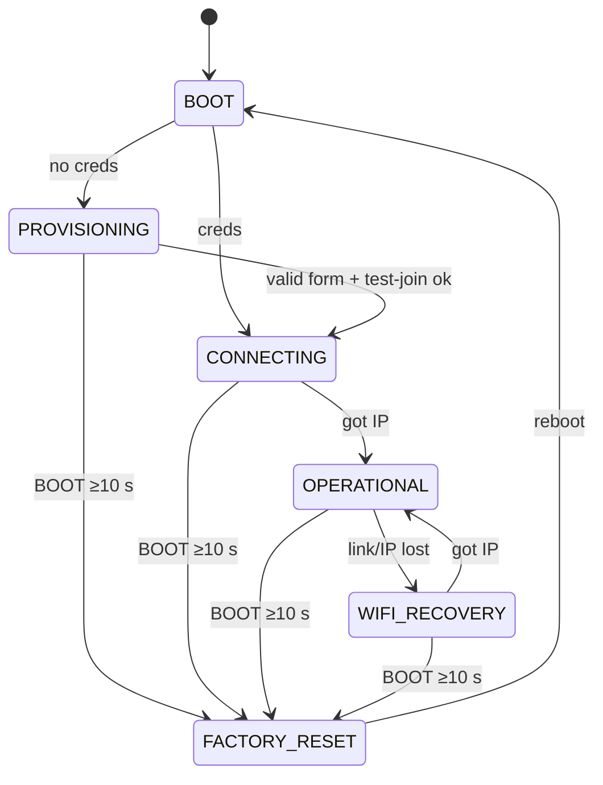

# MX320 WiFi Print Server — Functional Specification Document (FSD)

Provenance tags: `[user]` stated by the user · `[derived]` logical consequence of
a `[user]` decision · `[pack:esp32]` proposed by the ESP32 domain pack and
accepted by the user · `[tooling]` harvested from the sibling project's pinned
build tooling · `[proposed]` a value this document proposes that the user has not
yet accepted (`status: proposed` until accepted). Values accepted by the user
(OD-1, OD-2) carry no marker and are approved.

Requirement IDs follow `FR-<chapter>.<n>` / `NFR-<chapter>.<n>`. IDs are stable:
never renumbered, only `deprecated` or `superseded`.

## 1. System Overview

The MX320 WiFi Print Server makes a USB-only Canon PIXMA MX320 printable over
WiFi from macOS and Windows computers. A Seeed Studio XIAO ESP32-S3 is the USB
host for the printer and serves a raw (JetDirect, TCP 9100) print port on the
home WLAN. The client computer renders each job with its own MX320 driver; the
ESP32 forwards the resulting byte stream to the printer unchanged. Printer and
server status is visible on a web page and published to Home Assistant over
MQTT.

**Goals** `[user]`
- Print to the MX320 over WiFi from a Mac and from a Windows PC.
- Show printer status: presence, IEEE 1284 identity, ready / paper-out / error,
  job state — on an HTTP status page and over MQTT to Home Assistant.
- Join the WLAN through a captive portal; update firmware over WiFi (OTA).

**Goals** `[pack:esp32]`
- A task watchdog that turns a hung task into a reset.
- Factory reset by holding the BOOT button.
- Home Assistant MQTT discovery.

**Non-goals** `[user]` / `[derived]`
- No scanning, no fax (`[user]`: print + status only).
- No document rendering on the ESP32: no driverless AirPrint / IPP Everywhere /
  Mopria. Clients need an MX320-capable driver (`[derived]` — the MX320 speaks
  only Canon's proprietary raster, which the ESP32 cannot produce).
- No LPD, IPP, SMB, WSD or SNMP endpoints (`[user]`: RAW 9100 + mDNS).
- No bidirectional channel from printer to print client: data the printer
  returns on its bulk-IN endpoint is not forwarded to the TCP client (`[derived]`).
- No OTA rollback (offered, not selected — see §4 *Explicitly out of scope*).

**Users.** Household members printing from a Mac or Windows PC; the owner who
provisions, updates and recovers the device; Home Assistant as status consumer;
the testbench as automated observer during development.

**High-level flow.** Power on → no WiFi credentials: captive portal on a setup
SoftAP → credentials stored → join home WLAN → printer enumerated on USB →
`_pdl-datastream._tcp` advertised via mDNS → client opens TCP 9100 and streams a
rendered job → ESP32 writes the bytes to the printer's bulk-OUT endpoint → client
closes → job complete; status published.

## 2. System Architecture

### 2.1 Logical Architecture

```text
 Mac / Windows PC ──WiFi/LAN──▶ ESP32-S3 ──USB (host)──▶ active hub ──▶ Canon MX320
   (MX320 driver renders)       │  TCP 9100  RAW in                      (printer class)
                                │  mDNS      advertise
                                │  HTTP 80   status / settings / OTA
                                └─ MQTT 1883 ─▶ Home Assistant broker
```

Trust boundary: the home LAN (§22). The only path into the printer is the
ESP32's USB host port.

### 2.2 Hardware / Platform Architecture

**Product topology** `[user]`: the XIAO ESP32-S3's USB-C port (native USB-OTG,
GPIO19/20) is the **USB host**. It connects to the upstream port of an active
(self-powered) USB hub; the MX320 connects to a downstream port of that hub.

**Bench topology** `[user]`: identical product wiring, plus a USB-UART adapter
on XIAO D6/D7 (UART0) with BOOT/EN control lines, plugged into the testbench Pi
(192.168.8.70) — **not** into the product hub, whose host is the ESP32. The
testbench flashes and reads the console through that adapter; routine updates
go over OTA; logs also go to the testbench UDP log (§20).

Platform constraints — each one a number the build reads (§23 binds them to
build settings):

| ID | Constraint | Value | Source |
|---|---|---|---|
| NFR-2.1 | MCU | ESP32-S3 (Seeed XIAO ESP32-S3) | `[user]` |
| NFR-2.2 | Flash size the firmware requires | 8 MB; a unit with less than 8 MB flash cannot run this firmware | `[derived]` (XIAO ESP32-S3 fit) |
| NFR-2.3 | PSRAM | 8 MB octal PSRAM present and enabled; firmware fails its boot self-check without it | `[derived]` |
| NFR-2.4 | Console | UART0, TX = GPIO43 (D6), RX = GPIO44 (D7), 115200 8N1 | `[user]` (UART adapter) |
| NFR-2.5 | USB role | USB-OTG peripheral in host mode, full-speed (12 Mbit/s); USB-Serial/JTAG is not used as console | `[derived]` |
| NFR-2.6 | Factory-reset input | BOOT button, GPIO0, active low | `[pack:esp32]` |
| NFR-2.7 | USB hub depth | at most one external hub between ESP32 and printer | `[user]` |

| ID | Precondition · stimulus | Expected observation | Must NOT happen | Tier |
|---|---|---|---|---|
| NFR-2.1–2.3 | `esptool chip_id` + `flash_id` via UART adapter; boot log | Chip ESP32-S3, flash 8 MB, PSRAM 8 MB reported at boot | Boot continues without PSRAM | bench (commissioning) |
| NFR-2.4 | Reset DUT, read UART adapter | Boot banner at 115200 on GPIO43 | Banner only on USB-Serial/JTAG | bench |
| NFR-2.5 | Attach printer to USB-C via hub | FR-8.1 passes | — | bench |
| NFR-2.6 | Press BOOT while running | Log `button: down` / `button: up` (test build) | — | bench |
| NFR-2.7 | Printer behind two cascaded hubs | Printer not claimed; log `usb: hub depth exceeded` | Crash | bench |

Power: the XIAO and the hub are supplied by the hub's 5 V supply; the ESP32
cannot source USB VBUS. How VBUS reaches the hub's upstream port is a
commissioning question (§4, R1).

### 2.3 Software Architecture

FreeRTOS tasks: USB host daemon + printer-class client; RAW job forwarder
(TCP → USB, one job at a time); HTTP server (status, settings, OTA, captive
portal); MQTT client; status poller; button monitor. Persistent state lives in
NVS (§16). Firmware updates use two OTA slots (§16).

#### State model — device lifecycle (normative)

States are mutually exclusive. Printer presence (§8) and job state (§6) are
orthogonal sub-states of `OPERATIONAL` and `WIFI_RECOVERY`.

| State | Meaning | Persistent? |
|---|---|---|
| `BOOT` | Reset until NVS read | no |
| `PROVISIONING` | No stored WiFi credentials; setup SoftAP + captive portal active | no (derived from NVS on each boot) |
| `CONNECTING` | Credentials stored; joining the WLAN for the first time since boot | no |
| `OPERATIONAL` | STA associated with an IPv4 address; network services up | no |
| `WIFI_RECOVERY` | Was operational; STA link or IP lost; reconnecting | no |
| `FACTORY_RESET` | Erasing user configuration, then rebooting | no |

Transition table — **the table is normative; every row is a requirement**
(`FR-2.<row>`):

| ID | From | Event | Guard | To | Action | Limit |
|---|---|---|---|---|---|---|
| FR-2.10 | `BOOT` | NVS read | no WiFi credentials | `PROVISIONING` | Start setup SoftAP, DNS catch-all, portal | portal reachable ≤ 10 s after reset |
| FR-2.11 | `BOOT` | NVS read | credentials present | `CONNECTING` | Start STA | ≤ 2 s after reset |
| FR-2.12 | `CONNECTING` | got IPv4 | — | `OPERATIONAL` | Start RAW port (if printer present), mDNS, HTTP, MQTT | services up ≤ 5 s after IP |
| FR-2.13 | `CONNECTING` | connect fails / timeout | — | `CONNECTING` | Retry with backoff 1, 2, 4 … 60 s, unbounded | ceiling 60 s |
| FR-2.14 | `OPERATIONAL` | STA disconnected or IP lost | — | `WIFI_RECOVERY` | Abort active job (§6), stop RAW listener, mDNS, MQTT | ≤ 2 s |
| FR-2.15 | `WIFI_RECOVERY` | got IPv4 | — | `OPERATIONAL` | Restart services as FR-2.12 | RAW port accepting ≤ 30 s after AP returns |
| FR-2.16 | `WIFI_RECOVERY` | connect fails | — | `WIFI_RECOVERY` | Retry, backoff as FR-2.13 | ceiling 60 s |
| FR-2.17 | any but `BOOT` | BOOT held ≥ 10 s | — | `FACTORY_RESET` | Erase user config (§19), reboot | reboot ≤ 3 s after threshold |
| FR-2.18 | `PROVISIONING` | valid form submitted and STA test-join succeeds | — | `CONNECTING` | Persist config, stop SoftAP | ≤ 5 s after test-join |

Unhandled-event default: events not listed are logged at debug level and
discarded. Explicit exclusions: `PROVISIONING` never falls back to anything but
itself (no timeout reboot); `CONNECTING`/`WIFI_RECOVERY` never fall back to
`PROVISIONING` — the portal returns only via factory reset.
BOOT press < 10 s has no effect in any state (FR-2.19). Watchdog reset (§17)
enters `BOOT` like any reset.

**Prohibited transitions**: `WIFI_RECOVERY → PROVISIONING`; any transition that
erases configuration other than FR-2.17; a reboot as the means of WiFi recovery.



Verification contracts for the lifecycle:

```yaml
id: FR-2.15
verification:
  preconditions:
    - DUT OPERATIONAL on the bench AP, printer present, RAW port accepting.
  stimulus:
    - Disable the bench AP for 20 s, then re-enable it.
  expected_observations:
    - Log marker `wifi: lost` within 2 s of AP disable.
    - Log marker `wifi: got ip` after AP re-enable.
    - TCP connect to <ip>:9100 succeeds within 30 s of AP re-enable.
    - A 1 MiB test job sent after recovery arrives byte-identical at the USB sink.
  timing: 30 s from AP re-enable to RAW port accepting
  tolerance: +5 s
  prohibited_outcomes:
    - DUT reboots (boot counter / reset reason changes).
    - DUT starts the setup SoftAP.
    - Stored WiFi credentials change.
  tier: bench
  evidence: [AP toggle timestamps, UDP + UART log, /api/status before/after (boot_count, reset_reason), sink SHA-256]
  cleanup: [AP enabled, DUT OPERATIONAL]
```

```yaml
id: FR-2.17
verification:
  preconditions:
    - DUT OPERATIONAL with WiFi credentials, admin password and MQTT settings stored.
  stimulus:
    - Hold BOOT (GPIO0) low for 11 s, release.
  expected_observations:
    - Log marker `reset: factory` then a reboot.
    - After reboot the setup SoftAP `MX320-Setup-<id>` is visible within 10 s.
    - GET http://192.168.4.1/api/status shows `configured: false`.
  timing: reboot ≤ 3 s after the 10 s threshold
  tolerance: ±0.5 s on the 10 s threshold
  prohibited_outcomes:
    - DUT rejoins the home WLAN after reboot.
    - The OTA slots or running firmware version change.
    - Reset fires on a hold of 9 s (see FR-2.19).
  tier: bench
  evidence: [GPIO drive timestamps, UART log, SoftAP scan, /api/status]
  cleanup: [Re-provision DUT via portal (P-PROVISION)]
```

| ID | Precondition · stimulus | Expected observation | Must NOT happen | Tier |
|---|---|---|---|---|
| FR-2.10 | NVS erased · reset | SoftAP visible and `GET http://192.168.4.1/` returns 200 ≤ 10 s after reset | DUT joins any other network | bench |
| FR-2.11 | Credentials stored · reset | Log `state: CONNECTING` ≤ 2 s after reset | SoftAP started | target |
| FR-2.12 | Credentials stored, AP up · reset | `/api/status` 200 and mDNS answers ≤ 5 s after `wifi: got ip` | Services announced before IP | bench |
| FR-2.13 | Credentials for an absent SSID · reset | Retry log lines at intervals 1,2,4,…,60,60 s (±20 %) for 5 min | SoftAP started; reboot | bench |
| FR-2.14 | Job in progress · AP disabled | Log `job: abort reason=wifi` ≤ 2 s; MQTT/mDNS stopped | DUT reboots | bench |
| FR-2.16 | WIFI_RECOVERY, AP kept off 5 min | Retry intervals capped at 60 s | Reboot; SoftAP | bench |
| FR-2.18 | PROVISIONING · submit valid form for the bench AP | SoftAP gone and `wifi: got ip` ≤ 5 s after test-join log | Credentials persisted before test-join succeeded | bench |
| FR-2.19 | OPERATIONAL · hold BOOT 9 s | No state change; config unchanged; no reboot | `reset: factory` logged | bench |

### 2.4 Component Layering

Strict one-way dependency: each layer depends only on layers below it. The L0/L1
line is ownership — L0 is configured and used (ESP-IDF and managed components),
L1 is wire/handler logic this project writes and tests.

```text
┌──────────────────────────── L2  Application logic ─────────────────────────────┐
│  Device Lifecycle (§5)   Job Forwarder (§6)   Printer Status Derivation (§7)  │
├──────────────────────────── L1  Interfaces ────────────────────────────────────┤
│ USB Printer Link (§8)  RAW Port (§9)  Discovery (§10)  HTTP Status/Admin (§11) │
│ Captive Portal (§12)   MQTT / HA Publisher (§13)                               │
├──────────────────────────── L0  Foundation ────────────────────────────────────┤
│ WiFi STA/AP (§14)  USB Host Library + hub (§15)  NVS & OTA (§16)  RTOS/TWDT (§17)│
│ esp_http_server · esp-mqtt (managed) · mdns (managed) · lwIP                   │
└────────────────────────────────────────────────────────────────────────────────┘
```

Source-layout rules that make the code mirror these layers are HOW and live in
`docs/Method/project/architecture.md`.

## 3. Implementation Phases

Each phase is entered using only what earlier phases delivered.

### 3.1 Phase 1 — Platform alive on the bench

- **Scope:** build skeleton for ESP32-S3 with §23 constraints; UART0 console;
  boot banner; NVS; TWDT; lifecycle decision function; WiFi STA with
  compile-time **test** credentials (bench AP or home WLAN — a test-build
  option, removed from release by FR-12.7 in Phase 4); WiFi recovery; UDP log;
  HTTP `/api/status` (version, boot_count, reset_reason, state); OTA endpoint
  (§11) with a build-time admin password.
- **Deliverables:** firmware flashed via the UART adapter; OTA path proven.
- **Exit:** FR-5.1, FR-2.11, FR-2.12 (HTTP only), FR-2.13, FR-2.15, FR-2.16,
  FR-11.2, FR-11.3, FR-11.4, FR-11.6, NFR-16.1, NFR-17.1 (main task),
  FR-18.1 (banner + `/api/status`), FR-20.1–FR-20.2 (`boot:`, `state:`,
  `wifi:` markers), NFR-23.1 pass.
- **Depends on:** commissioning of the UART adapter wiring and bench AP (Phase 2
  of the journey, `/commission`).

### 3.2 Phase 2 — USB printer link

- **Scope:** USB host + hub support; printer-class client (§8); status
  derivation (§7); printer fields in `/api/status`.
- **Exit:** FR-8.1–FR-8.6, FR-7.1–FR-7.2, FR-20.1 (`usb:` markers) pass;
  printer identity of the real MX320 visible in `/api/status`.
- **Depends on:** Phase 1 (`/api/status`, OTA, logging); commissioning of the
  ESP32 → hub → MX320 power/VBUS arrangement (R1, R2).

### 3.3 Phase 3 — Printing

- **Scope:** RAW port (§9), job forwarder (§6), mDNS discovery (§10), HTML
  status page (FR-11.1).
- **Exit:** FR-6.x, NFR-6.1, FR-9.x, FR-10.x, FR-7.3, FR-8.7, FR-2.14,
  FR-11.1, FR-11.5, NFR-14.1, NFR-17.1 (all tasks), NFR-17.2, FR-20.1 (`job:` markers)
  pass at bench tier against the USB sink and the real MX320; acceptance AT-1
  (macOS) and AT-2 (Windows) pass.
- **Depends on:** Phase 2 (printer link), Phase 1 (WiFi, HTTP).

### 3.4 Phase 4 — Provisioning, settings, Home Assistant

- **Scope:** captive portal (§12), settings + admin password (FR-11.7–FR-11.8),
  factory reset (FR-2.17, FR-2.19), MQTT + HA discovery (§13), remove the
  compile-time bench credentials (FR-12.7).
- **Exit:** FR-2.10, FR-2.12 (all services), FR-2.17–FR-2.19, FR-11.7,
  FR-11.8, FR-12.x, FR-13.x, FR-18.1 (MQTT), NFR-22.x and every
  remaining Must/Should pass; AT-3 and AT-4 pass.
- **Depends on:** Phase 3 (job state to publish), Phase 1 (NVS, HTTP).

## 4. Risks, Assumptions & Dependencies

| ID | Risk | Likelihood | Impact | Mitigation |
|---|---|---|---|---|
| R1 | Hub does not enable downstream ports without VBUS on its upstream port, and the XIAO cannot source VBUS | Medium | High | Commission: measure upstream VBUS; feed hub 5 V to XIAO 5V pin (which is tied to USB-C VBUS) or use a hub that ignores upstream VBUS. Fallback: printer directly on XIAO USB-C with external 5 V. |
| R2 | ESP-IDF external-hub support (`CONFIG_USB_HOST_HUBS_SUPPORTED`) misbehaves with the chosen hub | Medium | High | Commission with the real hub in Phase 2; fallback: direct connection (FR-8.1 permits zero hubs). |
| R3 | MX320 port-status bits (paper-empty, select, not-error) are not maintained by Canon firmware | Medium | Medium | Commission: read port status with paper removed / lid open; if bits are static, FR-7.1 states degrade to `present`/`absent` and the spec is amended. |
| R4 | No MX320 driver for current macOS (Canon dropped support) | Medium | High | Dependency D3: Gutenprint "Canon PIXMA MX320" driver; AT-1 is the gate. |
| R5 | Windows Canon driver insists on bidirectional status and stalls on a raw port | Low | Medium | User manual: disable bidirectional support on the port. |
| R6 | Full-speed USB (≈ 1 MB/s) limits throughput | Low | Low | Printer mechanics are slower than the link; NFR-6.1 sized accordingly. |
| R7 | GPIO0 is a strapping pin; BOOT held during power-up enters download mode | Low | Low | Factory reset is detected only after boot (FR-2.17 guard "any but BOOT"). |

**Assumptions**
- A1 (assumed): the MX320 enumerates with an interface of class 0x07
  subclass 0x01 (USB printer class); VID 0x04A9 (Canon). Confirm at
  commissioning with the real printer.
- A2 (assumed): the home WLAN is 2.4 GHz WPA2-PSK with DHCP; the Mac and PC are
  on the same L2 segment (mDNS reaches them).
- A3 (assumed): the bench provides a test AP the testbench can switch on and off
  (testbench WiFi, 192.168.4.x) and a USB printer-class sink for byte-exact
  capture (see §24.0); the real MX320 is used for acceptance.

**Dependencies**
- D1 `[tooling]`: ESP-IDF v6.0.2 (`espressif/idf:v6.0.2` container, as in the
  sibling project); managed components `espressif/mdns`, `espressif/mqtt`.
- D2: Canon MX320 Windows driver (Canon download) on the Windows client.
- D3: Gutenprint (or Canon) MX320 driver on the macOS client.
- D4: An MQTT broker reachable from the WLAN (the Home Assistant broker) — only
  for §13.

**Explicitly out of scope**
- Scanning and fax `[user]`.
- LPD (515), IPP (631), SNMP `[user]` (offered, not selected).
- OTA rollback / boot-health confirmation `[pack:esp32]` (offered, not selected):
  a firmware that boots but cannot reach WiFi requires re-flashing via the UART
  adapter.
- Signed OTA images, secure boot, flash encryption `[user]` (security profile
  "Trusted home LAN", §22).
- ESP32 domain-pack families not selected in the curated subset: BLE, USB HID,
  Ethernet, offline MQTT buffering, MQTT commands (the device subscribes to no
  topic).

# Part A — Application Logic (L2)

## 5. Device Lifecycle

**Purpose.** Owns the state model in §2.3 — the normative transition table and
its contracts live there (FR-2.10 … FR-2.19) because the whole architecture
reads it. This chapter adds the decision function's own rule.

- **FR-5.1** [Must] `[derived]`: The lifecycle decision function shall be a
  pure function `(state, event, guard inputs) → (next state, actions)` whose
  outputs equal the §2.3 table for every listed row and return
  "ignored" for every unlisted (state × event) pair.

| ID | Precondition · stimulus | Expected observation | Must NOT happen | Tier |
|---|---|---|---|---|
| FR-5.1 | Enumerate all states × all events | Each listed row yields its next state/actions; each unlisted pair yields `ignored` | Any unlisted pair changes state | host |

## 6. Print Job Forwarder

**Purpose.** Moves one rendered job at a time from a RAW TCP connection (§9) to
the printer's bulk-OUT endpoint (§8), unchanged, with backpressure.

**Job state.** `IDLE → RECEIVING → DONE | ABORTED → IDLE`. A job begins when a
RAW connection is accepted and ends on client close (DONE) or on a fault
(ABORTED).

**Requirements**

- **FR-6.1** [Must] `[user]`: The device shall deliver every byte received on a
  RAW connection to the printer bulk-OUT endpoint in received order, without
  insertion, deletion or modification.
- **FR-6.2** [Must] `[derived]`: While a job is RECEIVING, the device shall not
  read data from any other RAW connection; bytes of two jobs shall never
  interleave.
- **FR-6.3** [Must] `[derived]`: A RAW connection queued behind an active job
  shall be serviced as the next job after the active job ends, without the
  client reconnecting (listen backlog ≥ 2).
- **FR-6.4** [Must] `[derived]`: On client close (TCP FIN) the device shall
  mark the job DONE after the last byte has been accepted by the printer, and
  close its side of the connection.
- **FR-6.5** [Must] `[derived]`: While the printer is not accepting data, the
  device shall stop reading from the TCP connection (backpressure); bytes held
  in device memory for the active job shall not exceed 64 KiB.
- **FR-6.6** [Must] `[derived]`: If the printer detaches during a job, the
  device shall mark the job ABORTED and reset the TCP connection within 5 s
  of detach.
- **FR-6.7** [Should] `[derived]`: A job connection on which no byte arrives for
  300 s while the device is ready to read shall be closed and the
  job marked DONE.
- **FR-6.8** [Must] `[derived]`: Time spent with the printer not accepting data
  (paper out, cover open) shall not count towards the FR-6.7 idle limit.
- **FR-6.9** [Should] `[user]`: The device shall count completed jobs, aborted
  jobs, and the byte length of the last job, from boot, and expose them via §11
  and §13.
- **NFR-6.1** [Should] `[user]`: With a sink that accepts data at full
  speed, sustained client-to-USB throughput shall be ≥ 300 KiB/s over a 10 MiB
  job.

```yaml
id: FR-6.6
verification:
  preconditions:
    - DUT OPERATIONAL, printer (or USB sink) present, a 10 MiB job streaming.
  stimulus:
    - Detach the printer (hub port power off or cable pull) at ~50 % of the job.
  expected_observations:
    - Client sees connection reset ≤ 5 s after detach.
    - Log `job: abort reason=usb` and jobs_aborted incremented.
    - After re-attach (FR-8.4), a new 1 MiB job prints byte-identical.
  timing: 5 s from detach to TCP RST
  tolerance: +1 s
  prohibited_outcomes:
    - DUT reboots.
    - The client sees a normal close (FIN) — the job would appear successful.
    - Bytes of the aborted job reach the printer after re-attach.
  tier: bench
  evidence: [detach timestamp, client socket error + timestamp, logs, /api/status, sink capture]
  cleanup: [printer attached, DUT idle]
```

| ID | Precondition · stimulus | Expected observation | Must NOT happen | Tier |
|---|---|---|---|---|
| FR-6.1 | Sink attached · send 10 MiB random job | Sink SHA-256 equals sent SHA-256 | Any byte difference or extra bytes | bench |
| FR-6.2 | Job A streaming · open job B and send 1 MiB | Sink receives all of A, then all of B | Any B byte before A's last byte | bench |
| FR-6.3 | Job A streaming · B connects and sends, waits | B completes after A without reconnect | B refused or dropped | bench |
| FR-6.4 | Send job, close | Client's close completes; jobs_completed +1; last_job_bytes = sent | Job counted before sink received last byte | bench |
| FR-6.5 | Sink paused (NAKs) · client sends 5 MiB | Client send blocks; `/api/status` `job.buffered_bytes` ≤ 65 536 throughout; status page answers ≤ 2 s | Free heap < 50 KiB; status unreachable | bench |
| FR-6.7 | Open connection, send 1 KiB, stay silent | Device closes connection 300 s (±5 s) later; job DONE | Close earlier than 295 s | target |
| FR-6.8 | Sink paused 400 s mid-job, then resumed | Job continues and completes byte-identical | Connection closed during pause | bench |
| FR-6.9 | Run 2 complete + 1 aborted job | Counters 2 / 1; last_job_bytes matches | Counters reset without reboot | bench |
| NFR-6.1 | Sink at full speed · 10 MiB job | Throughput ≥ 300 KiB/s client-measured | — | bench |

## 7. Printer Status Derivation

**Purpose.** Maps USB presence plus the IEEE 1284 port-status byte (§8) to the
printer status reported by §11 and §13.

- **FR-7.1** [Must] `[user]`: The status function shall map inputs to exactly
  one state per this table, evaluated top to bottom:

| Input | State |
|---|---|
| no printer claimed | `absent` |
| port status unreadable (control transfer failed) | `unknown` |
| bit 5 (PaperEmpty) = 1 | `paper_out` |
| bit 3 (NotError) = 0 | `error` |
| bit 4 (Select) = 0 | `offline` |
| otherwise | `ready` |

- **FR-7.2** [Must] `[derived]`: The device shall refresh port status at least
  every 5 s while a printer is claimed, including during a job.
- **FR-7.3** [Should] `[derived]`: The `printing` flag shall be true exactly
  while a job is RECEIVING, independent of the FR-7.1 state.

| ID | Precondition · stimulus | Expected observation | Must NOT happen | Tier |
|---|---|---|---|---|
| FR-7.1 | Feed every bit combination + absent + unreadable | Table output for each | Two states for one input | host |
| FR-7.2 | Printer claimed · remove paper (MX320) | `/api/status` shows `paper_out` ≤ 5 s (subject to R3) | Status stale > 5 s | bench |
| FR-7.3 | Start / end a job | `printing` true during, false ≤ 1 s after DONE | `printing` true while IDLE | bench |

# Part B — Interfaces (L1)

## 8. USB Printer Link

**Purpose & peer.** Hand-written USB printer-class client (USB Printer Class
1.1) on the ESP-IDF USB Host Library. Peer: the MX320 printer interface, direct
or behind one hub.

**Protocol.** Interface class 0x07, subclass 0x01, protocol 0x01 or 0x02.
Bulk-OUT for job data; bulk-IN drained and discarded; class requests
GET_DEVICE_ID (bRequest 0), GET_PORT_STATUS (1), SOFT_RESET (2).

- **FR-8.1** [Must] `[user]`: The device shall claim the first printer-class
  interface of a device attached directly or through one hub within 5 s
  of attach.
- **FR-8.2** [Must] `[user]`: On claim the device shall read the IEEE 1284
  Device ID and extract `MFG`/`MANUFACTURER`, `MDL`/`MODEL`, and `CMD`/
  `COMMAND SET` fields.
- **FR-8.3** [Must] `[derived]`: The device shall report the printer `absent`
  within 2 s of detach.
- **FR-8.4** [Must] `[derived]`: A printer re-attached after detach shall be
  re-claimed per FR-8.1 without a device reboot.
- **FR-8.5** [Should] `[derived]`: A USB device without a printer-class
  interface shall not be claimed and shall not interrupt a claimed printer.
- **FR-8.6** [Should] `[derived]`: A missing or unparseable Device ID shall
  leave the printer claimed, usable for printing, with model `unknown`.
- **FR-8.7** [Must] `[derived]`: After a job ABORTED with the printer still
  attached, the device shall issue SOFT_RESET before the next job.

| ID | Precondition · stimulus | Expected observation | Must NOT happen | Tier |
|---|---|---|---|---|
| FR-8.1 | DUT running · attach MX320 via hub | Log `usb: printer claimed vid=04a9 pid=…` ≤ 5 s; `/api/status` printer present | Claim of the scanner interface | bench |
| FR-8.2 | Feed sample 1284 strings (incl. long-key form, missing fields, no trailing `;`) | Parser returns MFG/MDL/CMD per sample | Crash; read past length | host |
| FR-8.3 | Printer claimed · detach | `absent` ≤ 2 s | DUT reboot | bench |
| FR-8.4 | Detach, re-attach 10× | Claimed each time ≤ 5 s; boot_count unchanged | Reboot; leaked handles (heap drops > 4 KiB over 10 cycles) | bench |
| FR-8.5 | Printer claimed · attach a USB flash drive on the hub | Drive ignored; job in progress completes byte-identical | Printer released | bench |
| FR-8.6 | Sink returns empty Device ID | Claimed, model `unknown`, job prints | Interface rejected | bench |
| FR-8.7 | Abort a job (client RST) with printer attached | Log `usb: soft_reset` before next job start | Next job starts without reset | bench |

## 9. RAW Print Port

**Purpose & peer.** JetDirect-style raw socket for print clients. Protocol:
TCP port 9100, client → device byte stream, no response data, end of job =
client close.

- **FR-9.1** [Must] `[user]`: In `OPERATIONAL` with a printer claimed, the
  device shall accept TCP connections on port 9100 of its STA address.
- **FR-9.2** [Must] `[derived]`: With no printer claimed, connection attempts to
  port 9100 shall be refused (TCP RST), so the client keeps the job queued.
- **FR-9.3** [Must] `[derived]`: The device shall send no payload bytes to a
  RAW client.

| ID | Precondition · stimulus | Expected observation | Must NOT happen | Tier |
|---|---|---|---|---|
| FR-9.1 | Printer present · TCP connect :9100 | Connection established | Refused | bench |
| FR-9.2 | Printer absent · TCP connect :9100 | Connection refused | Connection accepted and data discarded | bench |
| FR-9.3 | Send a job, read socket | 0 bytes received before close | Any byte | bench |

## 10. Discovery (mDNS / DNS-SD)

**Purpose & peer.** Lets macOS and Windows find the printer. Peer: any mDNS
querier on the LAN.

- **FR-10.1** [Must] `[user]`: In `OPERATIONAL`, the device shall answer mDNS A
  queries for `<hostname>.local` with its STA address.
- **FR-10.2** [Must] `[user]`: While a printer is claimed, the device shall
  advertise `_pdl-datastream._tcp` on port 9100 with instance name
  `<MDL> @ <hostname>` and TXT keys `txtvers=1`, `qtotal=1`, `ty=<MFG> <MDL>`,
  `product=(<MDL>)`, `usb_MFG=<MFG>`, `usb_MDL=<MDL>`.
- **FR-10.3** [Must] `[derived]`: The FR-10.2 service shall be withdrawn
  (goodbye packet) within 5 s of the printer becoming `absent`.
- **FR-10.4** [Should] `[derived]`: In `OPERATIONAL`, the device shall advertise
  `_http._tcp` on port 80.

| ID | Precondition · stimulus | Expected observation | Must NOT happen | Tier |
|---|---|---|---|---|
| FR-10.1 | OPERATIONAL · `dns-sd -G v4 <hostname>.local` / avahi-resolve | Resolves to STA IP | — | bench |
| FR-10.2 | Printer present · browse `_pdl-datastream._tcp` | Instance found with exact TXT keys/values; TXT-builder unit test passes | Missing key; port ≠ 9100 | host + bench |
| FR-10.3 | Detach printer | Service removed from browse ≤ 5 s | Service lingers | bench |
| FR-10.4 | Browse `_http._tcp` | Instance on port 80 | — | bench |

## 11. HTTP Status, Settings & OTA

**Purpose & peer.** Port 80, browser and scripts on the LAN. Status read
endpoints are unauthenticated; settings and OTA require the admin password via
HTTP Basic auth (user `admin`) — §22.

- **FR-11.1** [Must] `[user]`: `GET /` shall return an HTML page showing printer
  state, model, job counters, `printing`, WiFi RSSI and firmware version.
- **FR-11.2** [Must] `[user]`: `GET /api/status` shall return JSON matching the
  Appendix B schema within 2 s.
- **FR-11.3** [Must] `[user]`: `POST /api/ota` with valid credentials and a
  valid ESP32-S3 app image shall write the image to the inactive slot, reply
  200, and reboot into it within 5 s of the reply.
- **FR-11.4** [Must] `[derived]`: `POST /api/ota` without valid credentials
  shall return 401 and write nothing to flash.
- **FR-11.5** [Must] `[derived]`: `POST /api/ota` while a job is RECEIVING shall
  return 409 and write nothing to flash.
- **FR-11.6** [Must] `[derived]`: An image with bad magic, wrong chip ID, or
  size > 3 MB shall be rejected with 400; the device shall keep running the
  current firmware without reboot.
- **FR-11.7** [Must] `[user]`: `GET/POST /settings` (hostname, MQTT host/port/
  user/password, admin password change) shall require valid credentials;
  without them it shall return 401 and change nothing.
- **FR-11.8** [Must] `[derived]`: Settings changes shall be validated per §19;
  an invalid field shall be rejected with 400 naming the field, and no field of
  that submission shall be persisted.

```yaml
id: FR-11.3
verification:
  preconditions:
    - DUT OPERATIONAL running version V1; image V2 (different version string) built.
  stimulus:
    - curl -u admin:<pw> -F image=@V2.bin http://<ip>/api/ota
  expected_observations:
    - HTTP 200.
    - Reboot within 5 s (log `boot: fw=V2`).
    - /api/status reports version V2, reset_reason SW.
  timing: reboot ≤ 5 s after the 200
  tolerance: +2 s
  prohibited_outcomes:
    - Boot into V1 (slot not switched).
    - Stored configuration lost (DUT starts the SoftAP).
  tier: bench
  evidence: [curl output, UART log, /api/status before/after]
  cleanup: [OTA back to the baseline version]
```

| ID | Precondition · stimulus | Expected observation | Must NOT happen | Tier |
|---|---|---|---|---|
| FR-11.1 | GET / | 200, HTML containing the six fields | Password values present | bench |
| FR-11.2 | GET /api/status | Valid against Appendix B schema; ≤ 2 s | Missing required key | host (serializer) + bench |
| FR-11.4 | POST image, no / wrong auth | 401; running partition and inactive slot hash unchanged | Flash write | bench |
| FR-11.5 | Job streaming · POST valid image | 409; job completes byte-identical | Reboot mid-job | bench |
| FR-11.6 | POST truncated / ESP32-C3 / 3.1 MB image | 400; no reboot; version unchanged | Boot into partial image | bench |
| FR-11.7 | POST /settings without auth | 401; `/api/status` config unchanged | Any field persisted | bench |
| FR-11.8 | POST hostname `bad host!` + valid MQTT port | 400 naming `hostname`; MQTT port unchanged | Partial persist | host (validator) + bench |

## 12. Captive Portal

**Purpose & peer.** First-time WiFi setup from a phone or laptop while in
`PROVISIONING`. SoftAP SSID `MX320-Setup-<id>` (id per §18), open, IP
192.168.4.1; DNS catch-all answers every name with 192.168.4.1.

- **FR-12.1** [Must] `[user]`: In `PROVISIONING`, an HTTP GET to any host via
  the SoftAP shall return the setup page or a redirect to it (captive-portal
  detection on macOS, Windows, iOS, Android).
- **FR-12.2** [Must] `[user]`: The setup page shall list SSIDs from a scan and
  accept a manually entered SSID, WiFi password, admin password, and optional
  hostname and MQTT settings.
- **FR-12.3** [Must] `[derived]`: Before persisting, the device shall test-join
  the submitted network (AP+STA); on failure within 20 s it shall
  show an error on the page, stay in `PROVISIONING`, and persist nothing.
- **FR-12.4** [Must] `[derived]`: Submissions violating §19 validation (SSID
  1–32 bytes; WiFi password empty or 8–63 chars; admin password 8–64 chars)
  shall be rejected with a field error and persist nothing.
- **FR-12.5** [Must] `[derived]`: The SoftAP shall exist only in `PROVISIONING`.
- **FR-12.6** [Should] `[derived]`: The portal shall never echo the WiFi or
  admin password back in any response.
- **FR-12.7** [Must] `[derived]`: Release firmware shall contain no compiled-in
  WiFi credentials (the Phase 1 bench credentials are a test-build option only).

| ID | Precondition · stimulus | Expected observation | Must NOT happen | Tier |
|---|---|---|---|---|
| FR-12.1 | PROVISIONING · join SoftAP, GET http://example.com/ | Setup page or 302 to it | DNS failure | bench |
| FR-12.2 | GET setup page | Scan list includes the bench AP; manual SSID field present | — | bench |
| FR-12.3 | Submit bench SSID with wrong password | Error shown ≤ 20 s; still PROVISIONING; NVS has no creds after reboot | Credentials persisted | bench |
| FR-12.4 | Submit admin password of 7 chars | Field error; nothing persisted | Credentials persisted | host (validator) + bench |
| FR-12.5 | OPERATIONAL · scan from bench | No `MX320-Setup-*` SSID | SoftAP visible | bench |
| FR-12.6 | Submit form with error; inspect response | Password fields empty | Password value in HTML | bench |
| FR-12.7 | `strings` on release image | Bench SSID/password absent | Present | other (CI) |

## 13. MQTT / Home Assistant Publisher

**Purpose & peer.** Publishes status to an MQTT broker (Home Assistant). MQTT is
disabled while the broker host setting is empty. Base topic
`mx320/<id>`. QoS 1 for state and availability, retained.

- **FR-13.1** [Must] `[user]`: With a broker configured, the device shall
  publish the Appendix B status object to `mx320/<id>/state` (retained) within
  2 s of any change of printer state, `printing`, or job counters.
- **FR-13.2** [Should] `[derived]`: The device shall also republish
  `mx320/<id>/state` every 60 s.
- **FR-13.3** [Must] `[derived]`: The device shall publish `online` (retained) to
  `mx320/<id>/availability` on connect and register `offline` (retained) as its
  last-will.
- **FR-13.4** [Should] `[pack:esp32]`: On each broker connect the device shall
  publish retained Home Assistant discovery configs under
  `homeassistant/<component>/mx320_<id>/<object>/config` for: printer state
  (sensor), printing (binary_sensor), printer connected (binary_sensor), jobs
  completed (sensor), WiFi RSSI (sensor, diagnostic) — all with a shared
  `device` block (identifiers `mx320_<id>`, model `<MDL>`, sw_version).
- **FR-13.5** [Must] `[derived]`: Broker unavailability shall not affect
  printing.
- **FR-13.6** [Must] `[derived]`: After the broker becomes reachable again the
  device shall reconnect and publish current state within 30 s.

```yaml
id: FR-13.5
verification:
  preconditions:
    - DUT OPERATIONAL, broker configured and connected, printer present.
  stimulus:
    - Stop the broker; while stopped send a 5 MiB job; restart broker after 60 s.
  expected_observations:
    - Job completes byte-identical while broker is down.
    - FR-13.6 - state message with updated jobs_completed ≤ 30 s after broker restart.
  timing: 30 s from broker restart to fresh state message (FR-13.6)
  tolerance: +5 s
  prohibited_outcomes:
    - RAW port refuses or aborts the job.
    - DUT reboots.
    - Stale state (old jobs_completed) published as the recovery message.
  tier: bench
  evidence: [broker stop/start timestamps, sink hash, MQTT capture, /api/status boot_count]
  cleanup: [broker running]
```

| ID | Precondition · stimulus | Expected observation | Must NOT happen | Tier |
|---|---|---|---|---|
| FR-13.1 | Subscribed · complete a job | New retained state with counters +1 ≤ 2 s | — | bench |
| FR-13.2 | Idle 3 min | ≥ 3 state messages | Gap > 70 s | bench |
| FR-13.3 | Power off DUT | Broker publishes `offline` (keepalive expiry) | Retained `online` stays | bench |
| FR-13.4 | Connect; read retained `homeassistant/#` | Five configs, schema-valid, same device block | Discovery for non-listed entities | host (builder) + bench |
| FR-13.6 | see FR-13.5 contract | — | — | bench |

# Part C — Foundation (L0)

L0 services are configured, not owned; they are tested **transitively** through
the L1/L2 contracts referenced in each chapter.

## 14. WiFi STA / SoftAP

ESP-IDF WiFi driver in STA, AP (provisioning) and AP+STA (test-join) modes.
Exercised via FR-2.11–FR-2.18 and §12.

- **NFR-14.1** [Must] `[derived]`: In `OPERATIONAL` and idle, 19 of 20 mDNS A
  queries and 19 of 20 TCP connects to port 9100 shall be answered within
  500 ms. (Implementation note — power-save off — lives in the
  Method.)

| ID | Precondition · stimulus | Expected observation | Must NOT happen | Tier |
|---|---|---|---|---|
| NFR-14.1 | Idle 2 min · 20 mDNS queries, 20 connects, 3 s apart | ≥ 19 of each answered ≤ 500 ms | Any unanswered > 2 s | bench |

## 15. USB Host Library and Hub Support

ESP-IDF USB Host Library with external-hub support enabled. Exercised via §8.
Configuration bound in §23.

## 16. NVS and OTA Partitions

NVS holds the §19 persisted fields. Two OTA app slots; no factory app. Exercised
via FR-2.17, FR-11.3–FR-11.6, FR-12.3.

- **NFR-16.1** [Must] `[derived]`: Configuration stored in NVS shall survive OTA
  update and power cycle.

| ID | Precondition · stimulus | Expected observation | Must NOT happen | Tier |
|---|---|---|---|---|
| NFR-16.1 | Provisioned DUT · OTA to new version, then power-cycle | Rejoins WLAN; hostname/MQTT settings unchanged in `/api/status` | SoftAP started; a setting at default | bench |

## 17. RTOS and Task Watchdog

- **NFR-17.1** [Must] `[pack:esp32]`: The task watchdog shall supervise the job
  forwarder, USB client, HTTP server and main tasks, and reset the device when
  any of them fails to check in for 10 s; the next boot reports
  reset reason `TASK_WDT`.
- **NFR-17.2** [Must] `[derived]`: A printer stall (paper out) of 10 min during
  a job shall not trigger a watchdog reset.

```yaml
id: NFR-17.1
verification:
  preconditions:
    - DUT running a test build with the fault-injection hook (`/api/test/hang?task=forwarder`, test build only).
  stimulus:
    - Trigger the hang in the forwarder task.
  expected_observations:
    - Reset within 10 s (+2 s) of the trigger.
    - After reboot /api/status reset_reason = TASK_WDT, boot_count +1.
    - DUT returns to OPERATIONAL without operator action.
  timing: 10 s
  tolerance: +2 s
  prohibited_outcomes:
    - DUT stays hung (no reset within 15 s).
    - Reset reason reported as anything other than TASK_WDT.
    - Release image exposes the hang endpoint (checked separately in CI).
  tier: bench
  evidence: [trigger timestamp, UART log incl. panic output, /api/status after]
  cleanup: [flash baseline release image]
```

| ID | Precondition · stimulus | Expected observation | Must NOT happen | Tier |
|---|---|---|---|---|
| NFR-17.2 | Sink paused 10 min during a job | No reset; job completes after resume | reset_reason TASK_WDT | bench |

# Part D — Cross-cutting Concerns

## 18. Device Identity

- `<id>`: lowercase hex of the last 3 bytes of the WiFi STA MAC (e.g. `a1b2c3`).
- Default hostname: `mx320-<id>`.
- Firmware version: the git tag (`vX.Y.Z`), or `vX.Y.Z-<n>-g<sha>` between tags,
  embedded at build time.
- **FR-18.1** [Must] `[derived]`: The firmware version reported by `/api/status`,
  the boot banner and MQTT `sw_version` shall be the same string.

| ID | Precondition · stimulus | Expected observation | Must NOT happen | Tier |
|---|---|---|---|---|
| FR-18.1 | Boot tagged build | Same version in UART banner, /api/status, discovery config | Mismatch | bench |

## 19. Configuration Catalogue

| Name | Type | Default | Valid range | Persistence | Sensitivity | Interface | Change effect | Factory reset |
|---|---|---|---|---|---|---|---|---|
| `wifi_ssid` | string | none | 1–32 bytes | NVS | operational | portal | next boot | cleared |
| `wifi_pass` | string | none | empty (open) or 8–63 chars | NVS | secret | portal | next boot | cleared |
| `admin_pass` | string | none | 8–64 chars | NVS | secret | portal, /settings | immediate | cleared |
| `hostname` | string | `mx320-<id>` | 1–32 chars `[a-z0-9-]`, not starting/ending `-` | NVS | public | portal, /settings | next boot | default |
| `mqtt_host` | string | empty (MQTT off) | empty, IPv4 dotted quad, or DNS name ≤ 64 chars | NVS | operational | portal, /settings | next MQTT connect | cleared |
| `mqtt_port` | int | 1883 | 1–65535 | NVS | public | portal, /settings | next MQTT connect | default |
| `mqtt_user` | string | empty | 0–64 chars | NVS | operational | portal, /settings | next MQTT connect | cleared |
| `mqtt_pass` | string | empty | 0–64 chars | NVS | secret | portal, /settings | next MQTT connect | cleared |
| `udp_log_host` | IPv4 | build-time: empty in release, `192.168.8.70` in test builds `[proposed]` | IPv4 dotted quad or empty | build-time | public | build | rebuild | n/a |
| `boot_count` | uint32 | 0 | — | NVS | public | read-only | each boot +1 | retained |

Each validation rule owes a negative test (FR-11.8, FR-12.4); each persistence
rule owes a persistence test (NFR-16.1, FR-2.17).

## 20. Logging / Observability

UART0 at 115200 (§2.2) and, when `udp_log_host` is set, the same lines as UDP
datagrams to `<udp_log_host>:5555` (testbench UDP log).

- **FR-20.1** [Must] `[derived]`: The device shall emit these marker lines,
  which tests match: `boot: fw=<ver> reset=<reason> count=<n>`,
  `state: <STATE>`, `wifi: got ip <ip>`, `wifi: lost`,
  `usb: printer claimed vid=<hex> pid=<hex> mdl=<MDL>`, `usb: printer absent`,
  `usb: soft_reset`, `job: start id=<n>`, `job: done id=<n> bytes=<n>`,
  `job: abort id=<n> reason=<usb|wifi|client|ota>`, `reset: factory`.
- **FR-20.2** [Should] `[derived]`: When `udp_log_host` is set and the device is
  `OPERATIONAL`, every FR-20.1 marker shall also arrive at the UDP log.
- No log line shall contain the WiFi, admin or MQTT password (NFR-22.2).

| ID | Precondition · stimulus | Expected observation | Must NOT happen | Tier |
|---|---|---|---|---|
| FR-20.1 | Run boot → print → detach sequence | All listed markers in UART log in order | Marker missing | bench |
| FR-20.2 | Same, test build | Same markers in `/api/udplog` | — | bench |

## 21. Error Handling

Failure behaviour is specified in the owning chapter: WiFi loss FR-2.14/2.15,
printer detach FR-6.6/FR-8.3, printer stall FR-6.5/6.8/NFR-17.2, broker loss
FR-13.5/13.6, bad OTA FR-11.4–11.6, bad input FR-11.8/FR-12.3/12.4, hang
NFR-17.1. No failure is handled by a deliberate reboot except OTA (FR-11.3),
factory reset (FR-2.17) and the watchdog (NFR-17.1).

## 22. Security

**Profile: Trusted home LAN** `[user]`.
- Threat actors considered: a guest or compromised device on the home LAN
  attempting to reflash or reconfigure the device.
- Not considered: attackers with physical access; passive sniffing on the LAN
  or WLAN; attackers within radio range during the provisioning window.
- Trusted network: the home WLAN. No exposure beyond it is intended (no port
  forwarding, no cloud).
- Print and status endpoints are open to the LAN by design; OTA and settings
  changes require the admin password.

Derived requirements:
- **NFR-22.1** [Must] `[derived]`: OTA and settings changes shall require the
  admin password (FR-11.4, FR-11.7).
- **NFR-22.2** [Must] `[derived]`: No HTTP response, MQTT message or log line
  shall contain the WiFi, admin or MQTT password.
- **NFR-22.3** [Should] `[derived]`: After 5 consecutive failed admin
  authentications the device shall reject authentication attempts for 60 s
  (returning 429).

| ID | Precondition · stimulus | Expected observation | Must NOT happen | Tier |
|---|---|---|---|---|
| NFR-22.1 | See FR-11.4 / FR-11.7 | — | — | bench |
| NFR-22.2 | Set known passwords; capture all of /, /api/status, /settings, MQTT, UART, UDP | No capture contains any password | Any occurrence | bench |
| NFR-22.3 | 5 wrong auths, then a correct one | 6th attempt gets 429; correct auth succeeds after 60 s | Correct auth accepted within lockout | bench |

**Accepted risks** (no requirement written):
- No TLS: the admin password travels in clear (HTTP Basic) on the LAN.
- No confidentiality at rest: passwords are stored unencrypted in NVS; no flash
  encryption; anyone with the device and a USB-UART adapter can read them.
- No secure boot or signed OTA: anyone holding the admin password can install
  arbitrary firmware.
- The provisioning SoftAP is open: someone in radio range during provisioning
  could submit settings first.
- Print jobs are unauthenticated: any LAN host can print.

## 23. Build & Tooling Constraints

Numbers the build reads, so no tool default chooses them:

| Setting | Value |
|---|---|
| ESP-IDF | v6.0.2 `[tooling]` |
| Target | `esp32s3` |
| Flash size | 8 MB (`CONFIG_ESPTOOLPY_FLASHSIZE_8MB`) |
| PSRAM | octal, enabled (`CONFIG_SPIRAM`, `CONFIG_SPIRAM_MODE_OCT`) |
| Console | UART0, GPIO43/44, 115200; USB-Serial/JTAG console disabled |
| USB host | `CONFIG_USB_HOST_HUBS_SUPPORTED=y`, external hub depth 1 |
| Partition table (custom) | `nvs` 0x9000 size 0x6000 · `otadata` 0xF000 size 0x2000 · `phy_init` 0x11000 size 0x1000 · `ota_0` 0x20000 size 0x300000 · `ota_1` 0x320000 size 0x300000 |
| App image ceiling | 3 MB (0x300000); a build producing a larger image fails |
| Managed components | `espressif/mdns`, `espressif/mqtt` (pinned in `dependencies.lock`) |

- **NFR-23.1** [Must] `[derived]`: The release image shall build with the above
  settings and be ≤ 0x300000 bytes.

| ID | Precondition · stimulus | Expected observation | Must NOT happen | Tier |
|---|---|---|---|---|
| NFR-23.1 | CI build of release config | Build succeeds; `esp_idf_size` app ≤ 0x300000; partition table matches §23 | Default partition table used | other (CI) |

# Part E — Operations & Verification

## 24. Operational Procedures

Reading path (detail lives in the referenced chapters and in the user manual):
first flash via UART adapter (§2.2, §23) → provision through captive portal
(§12) → printer attached and claimed (§8) → add printer on Mac / PC as raw
socket `<hostname>.local:9100` (§9, §10) → print (§6) → watch status on `/` or
Home Assistant (§11, §13) → update via OTA (FR-11.3) → recover: factory reset
(FR-2.17) or re-flash via UART adapter.

## 25. Verification & Validation

### 25.0 Test Architecture

| Tier | Runs on | Covers |
|---|---|---|
| **host** | Dev machine / CI, plain C | L2 pure functions (FR-5.1, FR-7.1), L1 pure cores: 1284 parser, mDNS TXT builder, status JSON serializer, HA discovery builder, config validators |
| **target** | XIAO ESP32-S3 on the bench, no peers needed | NVS, timers, idle-timeout logic, boot path |
| **bench** | DUT + testbench AP + USB printer-class sink + real MX320 + MQTT broker | everything end-to-end, recovery, timing |
| **other** | CI | image size, absence of bench credentials / test endpoints in release image |

Layer mapping: L0 tested transitively; L1 pure core at host, wire/flow at bench;
L2 at host. The **USB printer-class sink** is a bench instrument that
enumerates as a USB printer, records every bulk-OUT byte, can pause (NAK) on
command and can return a configurable Device ID and port status — required for
byte-exact and stall contracts; the real MX320 cannot report what it received.
Whether the testbench already provides it is a `/build` / `/commission`
question.

The component × tier matrix is generated by `/build` from
`testing/test-plan.yaml`.

### 25.1 Acceptance Tests

| ID | Scenario | Pass | Judged by |
|---|---|---|---|
| AT-1 | macOS: add printer via Bonjour (`_pdl-datastream`) with MX320 driver, print a 1-page PDF | Page prints legibly, no extra blank or garbage pages | operator (photo as evidence) |
| AT-2 | Windows 11: Standard TCP/IP port RAW 9100, Canon MX320 driver, print a test page | Same | operator |
| AT-3 | Fresh device: provision via phone captive portal, then AT-1 | Same | operator |
| AT-4 | Home Assistant shows the device with five entities; paper-out appears in HA ≤ 10 s | Entities present, states correct | operator |

### 25.2 Traceability

Generated, not hand-maintained: `/build`'s report computes coverage from the
requirement IDs in these chapters and the entries in `testing/test-plan.yaml`.

## Appendix A — Constants

| Constant | Value |
|---|---|
| RAW port | TCP 9100 |
| HTTP port | 80 |
| mDNS services | `_pdl-datastream._tcp`, `_http._tcp` |
| SoftAP | SSID `MX320-Setup-<id>`, open, 192.168.4.1/24, channel 1 |
| UDP log | `<udp_log_host>:5555` |
| MQTT base | `mx320/<id>` |
| USB printer class | class 0x07, subclass 0x01; GET_DEVICE_ID 0, GET_PORT_STATUS 1, SOFT_RESET 2 |
| Canon VID | 0x04A9 (A1) |

## Appendix B — Status object (`/api/status`, MQTT state)

```json
{
  "fw": "v0.1.0",
  "id": "a1b2c3",
  "hostname": "mx320-a1b2c3",
  "state": "OPERATIONAL",
  "configured": true,
  "boot_count": 12,
  "reset_reason": "POWERON",
  "uptime_s": 3600,
  "wifi": { "ssid": "home", "rssi": -58, "ip": "192.168.8.123" },
  "printer": {
    "present": true,
    "status": "ready",
    "mfg": "Canon",
    "mdl": "MX320 series",
    "vid": "04a9",
    "pid": "1736"
  },
  "printing": false,
  "job": { "buffered_bytes": 0, "completed": 4, "aborted": 0, "last_bytes": 1048576 },
  "mqtt": { "enabled": true, "connected": true },
  "heap_free": 180000
}
```

Required keys: all shown. `printer.status` ∈ {`absent`, `unknown`, `ready`,
`paper_out`, `error`, `offline`}. When `present` is false, `mfg`/`mdl`/`vid`/
`pid` are `null`. `pid` value above is illustrative, not normative (A1).

## Appendix C — Document Control

```yaml
document_status: draft
fsd_version: 0.1.1
repository: esp-to-mx320-printserver (local git; no remote yet)
baseline_commit: (initial commit)
applicable_firmware_version: none yet
author: user + Claude (/define)
reviewers: []
approval_status: pending — OD-1/OD-2 accepted; OD-3/OD-4 open; udp_log_host default still proposed
created: 2026-11-01
last_updated: 2026-11-01
change_history:
  - 0.1.0 2026-11-01 initial FSD
  - 0.1.1 2026-11-01 OD-1 and OD-2 accepted by the user; values approved
superseded_requirements: []
open_decisions:
  - id: OD-3
    gates: [FR-7.1, FR-7.2]
    text: R3 — whether the MX320 maintains 1284 port-status bits; resolved at commissioning.
  - id: OD-4
    gates: [FR-6.1, FR-6.5, FR-6.8, NFR-6.1, FR-8.5–FR-8.7, NFR-17.2]
    text: Availability of a USB printer-class sink on the bench (A3); without it these contracts can only run against the real MX320 and lose byte-exactness.
related_test_baseline: testing/test-plan.yaml (not yet created — Phase 1 of the journey)
```

## Related

- `docs/Method/` — build contract
- `docs/UserDocumentation/User-Manual.md` — operation
